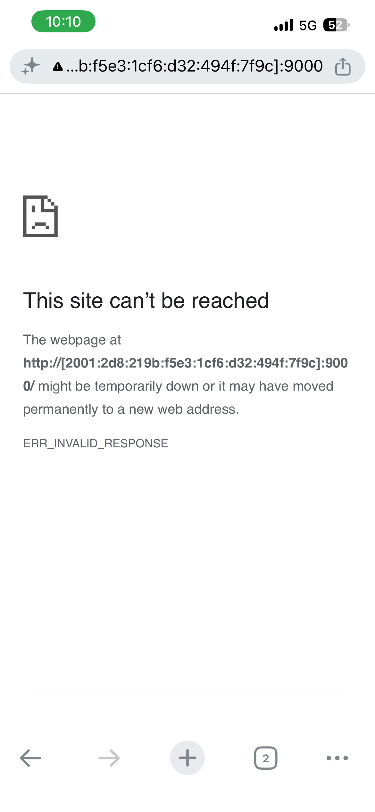
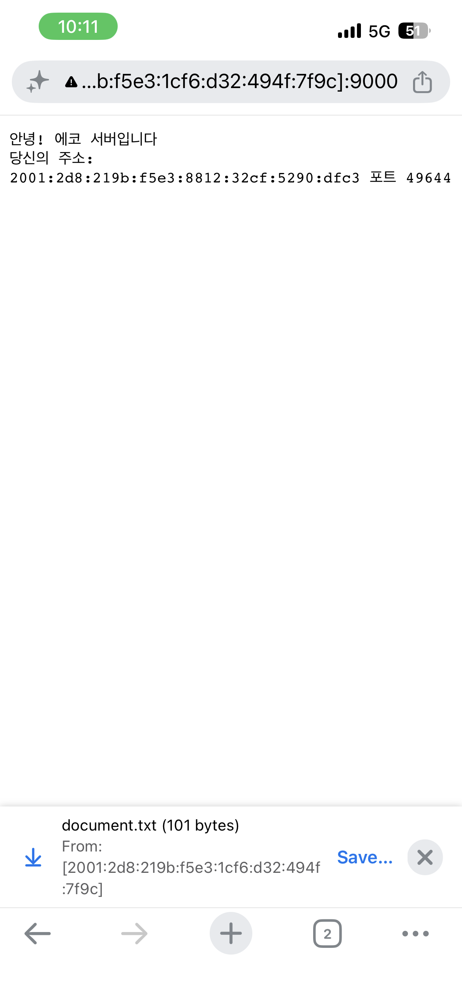

# 과제 A. TCP 에코 서버 — 이주영

> 진행 중 (10/24). 단계별로 이해한 내용은 [NOTES.md](./NOTES.md).

## 무엇을 만들었나
- Python `socket` 만으로 받은 글자를 그대로 돌려주는 TCP 에코 서버
- 손님마다 스레드를 붙여 여러 클라이언트를 동시에 받는다 (메인 스레드는 `accept()` 만 반복)
- 덤: 같은 소켓 위에서 `HTTP/1.1 200 OK` 응답을 직접 만들어 휴대폰 브라우저에 글자를 띄웠다
- 제출 코드 `echo_server.py` 는 직접 다시 작성 중

## 무엇을 확인했나
<!-- 체크리스트 항목마다 캡처나 로그를 하나씩 붙인다 -->
- [ ] 클라이언트 3개 동시 접속 시 IP·포트 로그, 포트가 각각 다름: 캡처 예정
  - 확인은 했다: `lsof` 에 서버 쪽 `9000->59167`, `9000->59168`, `9000->59169` 세 연결
- [ ] 127.0.0.1 바인딩 — 휴대폰에서 접속 안 됨: 캡처 예정
- [x] 0.0.0.0(IPv6 `::`) 바인딩 — 휴대폰에서 접속됨 (회사 Wi-Fi 는 기기 간 통신이 막혀 휴대폰 핫스팟으로)
  - 에코 응답이라 브라우저가 거절: 
  - HTTP 형식으로 응답하자 휴대폰 화면에 자기 주소가 뜸: 

## 예상과 달랐던 점
<!-- 직접 쓴다. 재료는 NOTES.md 의 2·3·6·7·8절 -->
- 

## 데모 순서 (7분)
1. 
