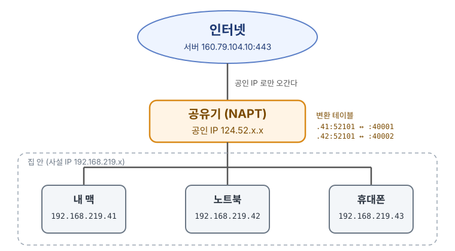
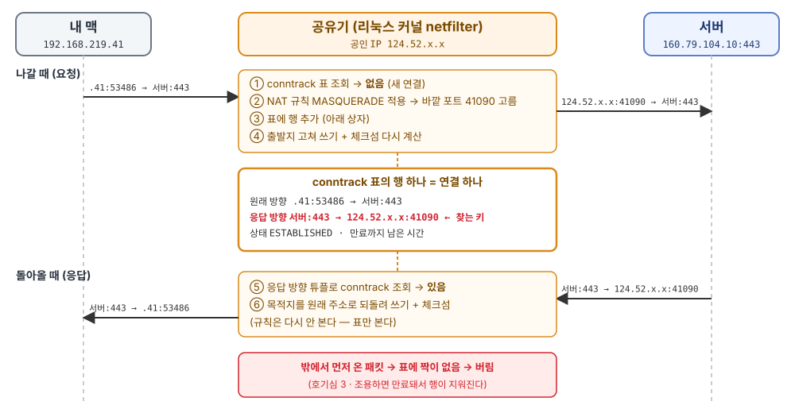

# 포트와 NAT

1주차 · 2026-10-19 · 이주영

---

<!-- Q06 · Q07 다시 풀기 -->

---

## 호기심1. 브라우저에서 특정 사이트를 열면, 내 포트는 몇 번일까?

- 주소창에 `https://naver.com`을 쳤을 때 무사히 해당 서버로 접근하게 되고 정상적인 리소스도 받아오게 된다. 그런데 나는 내 컴퓨터의 포트를 지정한 적은 없다.
- 그런데 TCP 연결에는 **클라이언트/서버 모두** 포트가 있어야 한다

> 요청하는 쪽 포트는 **누가**, **어떤 범위에서**, **어떻게** 정했을까?

포트 정의 : 같이 이야기해보시죠~ (다음 장 정의 있음)

---

**포트 정의** : A software-based communication endpoint that **directs network data** to the **correct application** or **service** on a computer. (컴퓨터 네트워크와 운영 체제에서 데이터가 전송되는 논리적인 통로(종단점))

## 같이 고민해 보기

1. 난 포트를 고른 적이 없는데 그럼 누가 골랐을까?
2. 서버 포트는 왜 늘 `443` 으로 **고정**일까? 서버도 아무 번호나 쓰면?
3. 같은 서버에 연결이 여러 개 붙어 있는데, 서버는 클라이언트를 각각 어떻게 식별할까?

---

## 확인해보시죠: 터미널을 통해 확인해보시죠

```
$ lsof -iTCP -sTCP:ESTABLISHED -n -P | grep :443
192.168.219.41:5xxxx -> 160.79.104.10:443
192.168.219.41:5xxxx -> 160.79.104.10:443
192.168.219.41:5xxxx -> 160.79.104.10:443
```

- 오른쪽(서버) 포트는 전부 `443` — HTTPS 의 **잘 알려진 포트**
- 왼쪽(내 쪽) 포트는 줄마다 다르고, 전부 **5만번대**

```
$ sysctl net.inet.ip.portrange.first net.inet.ip.portrange.last
net.inet.ip.portrange.first: 49152
net.inet.ip.portrange.last: 65535
```

---

## 알고 있지만 다시 정리해보면 포트 번호는 세 구역으로 나뉩니다.

| 구역           | 범위              | 누가 쓰나                                   |
| -------------- | ----------------- | ------------------------------------------- |
| 잘 알려진 포트 | 0 ~ 1023          | 표준 서비스 (80 HTTP · 443 HTTPS · 22 SSH)  |
| 등록된 포트    | 1024 ~ 49151      | 특정 애플리케이션 (5432 Postgres 등)        |
| **동적 포트**  | **49152 ~ 65535** | **OS 가 클라이언트에게 잠깐 빌려주는 번호** |

- 범위는 OS 마다 다르다 (리눅스 기본 32768 ~ 60999)

---

## 서버로 요청을 보내고 클라이언트로 응답이 오는 단계를 살펴보시죠

|     ① 포트 설정      |  →  |             ② 담기              |  →  |           ③ 구분한다           |  →  |             ④ 응답             |
| :------------------: | :-: | :-----------------------------: | :-: | :----------------------------: | :-: | :----------------------------: |
|     **내 맥 OS**     |     |          **패킷 헤더**          |     |            **서버**            |     |        **서버 → 내 맥**        |
| 빈 번호 `52101` 배정 |     | IP 헤더에 IP<br>TCP 헤더에 포트 |     | 4-튜플로<br>어느 연결인지 찾음 |     | 출발지·목적지를<br>뒤집어 보냄 |

```
요청   192.168.219.41:52101  ──────▶  160.79.104.10:443
응답   192.168.219.41:52101  ◀──────  160.79.104.10:443
```

- 클라이언트 포트는 **①에서 한 번** 정해지고, ②~④ 내내 해당 포트로 통신이 이루어진다.

Q. 혹시 4-tuple에 대해서 아시나요?

---

## 4-튜플? 서버 OS가 연결을 관리하는 방식

```ts
type Connection = [srcIp, srcPort, dstIp, dstPort]; // 튜플 = 값을 순서대로 묶은 것
```

서버 OS 는 열린 연결을 **표**로 들고 있고, 4-튜플이 그 표의 **기본 키**다

| 출발지 IP      | 출발지 포트 | 목적지 IP     | 목적지 포트 | → 연결          |
| -------------- | :---------: | ------------- | :---------: | --------------- |
| 192.168.219.41 |  **52101**  | 160.79.104.10 |     443     | A · 메인 페이지 |
| 192.168.219.41 |  **52188**  | 160.79.104.10 |     443     | B · 이미지      |
| 192.168.219.41 |  **52230**  | 160.79.104.10 |     443     | C · 스크립트    |

- 패킷이 오면 헤더의 네 값으로 이 표를 **조회** → 어느 연결인지 찾는다
- 기본 키라서 **겹치면 안 된다** → 하나만 달라도 다른 연결

다시 서버로 요청을 보내고 클라이언트로 응답이 오는 단계를 살펴보시죠.

---

## ① 포트 설정: 연결을 맺을 때 OS 가 빈 포트를 붙인다

```
브라우저: "160.79.104.10:443 에 연결해 줘"   ← 포트는 말하지 않음
   │
   ▼
OS: 동적 포트 범위에서 지금 안 쓰는 번호 → 52101 배정
```

- **누가**: 브라우저가 아니라 OS
- **언제**: 요청마다가 아니라 **연결을 맺을 때 한 번**. keep-alive 로 요청이 여러 번 오가도 번호는 그대로
- 이 번호를 **임시 포트(ephemeral port)** 라고 부른다. 연결이 끝나면 반납

---

## ② 담기: 포트는 TCP 헤더에, IP 는 IP 헤더에

| IP 헤더                    | TCP 헤더            | 데이터    |
| -------------------------- | ------------------- | --------- |
| 출발지 IP `192.168.219.41` | 출발지 포트 `52101` | HTTP 요청 |
| 목적지 IP `160.79.104.10`  | 목적지 포트 `443`   |           |

- 이 연결의 **모든 패킷**에 같은 번호가 실린다
- 네 값은 두 헤더에 나뉘어 실린다 → 합친 것이 **4-튜플**

---

## ③ 구분한다: 서버는 4-튜플로 연결을 가린다

```
           출발지 IP        출발지 포트   목적지 IP        목적지 포트
연결 A   192.168.219.41      52101      160.79.104.10      443
연결 B   192.168.219.41      52188      160.79.104.10      443
연결 C   192.168.219.41      52230      160.79.104.10      443
                            └ 여기만 다름 ┘
```

- 네 값 중 **하나만 달라도 다른 연결**
- 그래서 OS 는 **안 쓰는** 번호를 골라야 한다 — 겹치면 두 연결을 구분할 수 없다
- 서버는 `443` 하나로 수많은 클라이언트를 받는다. 구분은 클라이언트 쪽 칸이 맡는다

---

## ④ 응답: 출발지와 목적지를 뒤집어 돌려보낸다

```
요청   192.168.219.41:52101  ──────▶  160.79.104.10:443
응답   192.168.219.41:52101  ◀──────  160.79.104.10:443
       (응답 패킷에서는 이쪽이 목적지)
```

- 서버는 클라이언트 주소를 **미리 알 필요가 없다** — 들어온 패킷의 출발지 칸에 적혀 있다
- 서버가 하는 일 두 가지
  1. 이 패킷이 **어느 연결** 것인지 찾는다 (4-튜플)
  2. 답장을 **어디로** 보낼지 정한다 (출발지 IP·포트를 목적지로)

---

## 정리

> 서버는 **먼저 찾아와야 하는 쪽**을 위해 번호를 고정하고,
> 클라이언트는 **답장 주소를 패킷에 실어 보내니까** OS 가 고른 빈 번호를 써도 된다.

- 그런데 공유기 뒤에 노트북이 여러 대면? 출발지 IP 가 모두 공인 IP 하나로 바뀐다
- → 우연히 포트까지 같으면 4-튜플이 겹친다. 여기서 **NAPT** 가 시작된다 (질문 2)

---

## 공유기의 역할이 무엇인가요?

---

## 공유기가 하는 일 네 가지

| 역할                            | 한 줄로                                            |
| ------------------------------- | -------------------------------------------------- |
| **1. 주소 나눠 주기** (DHCP)    | 집 안 기기에 사설 IP 배정 — 내 맥 `192.168.219.41` |
| **2. 길 안내** (게이트웨이)     | 밖으로 가는 패킷은 전부 공유기 `192.168.219.1` 로  |
| **3. 주소 바꾸기** (NAT · NAPT) | 나갈 때 사설 IP → 공인 IP `124.52.x.x`             |
| **4. 무선 연결** (Wi-Fi)        | 기기를 전파로 집 안 네트워크에 붙인다              |

---

<style scoped>
table tbody tr:nth-child(3) td { color: #d1242f; font-weight: 700; background: #ffebe9; }
table tbody tr:nth-child(3) td:first-child { border-left: 4px solid #d1242f; }
</style>

## 오늘 살펴볼 것은 3. 주소 바꾸기

| 역할                            | 한 줄로                                            |
| ------------------------------- | -------------------------------------------------- |
| **1. 주소 나눠 주기** (DHCP)    | 집 안 기기에 사설 IP 배정 — 내 맥 `192.168.219.41` |
| **2. 길 안내** (게이트웨이)     | 밖으로 가는 패킷은 전부 공유기 `192.168.219.1` 로  |
| **3. 주소 바꾸기** (NAT · NAPT) | 나갈 때 사설 IP → 공인 IP `124.52.x.x`             |
| **4. 무선 연결** (Wi-Fi)        | 기기를 전파로 집 안 네트워크에 붙인다              |

- 주소를 바꿔줘야하는 이유는 사설 IP는 인터넷망을 사용하지 못하기 때문에 공인 IP로 포워딩해줘야한다.

---

## 호기심 2: 공유기는 서버로부터 받은 응답을 어느 클라이언트에 줄까?



- 집 안은 **사설 IP**(10.x · 172.16~31.x · 192.168.x), 인터넷에서는 **공인 IP** 하나
- 공유기가 **출발지를 공인 IP 로 바꿔** 내보내는데 서버 입장에선 세 기기가 모두 `124.52.x.x`이다.
- 그럼 서버로 부터 받은 응답은 어떻게 클라이언트를 식별해서 전달해줄 수 있는거지?

---

## NAT 와 NAPT 는 무엇이고, 왜 있나?

**NAT** (Network Address Translation, 네트워크 주소 변환)

- 패킷이 공유기를 지날 때 **IP 주소를 다른 IP 로 바꿔 쓰는 것**
- 나갈 때: 출발지 사설 IP → 공인 IP · 돌아올 때: 목적지 공인 IP → **원래 사설 IP**

**NAPT** (Network Address **Port** Translation)

- NAT 에 더해 **포트 번호까지** 바꿔 쓰는 것 → 공인 IP **하나**를 여러 기기가 나눠 쓴다
- 우리가 집·회사에서 "NAT" 라고 부르는 건 대부분 이것이다.

---

## NAT 와 NAPT 는 무엇이고, 왜 있나?

### 왜 있나?

- IPv4 주소는 2³² ≈ **43억 개**뿐 — 기기 수보다 적다.
- 그래서 안에서는 사설 IP([RFC 1918](https://www.rfc-editor.org/rfc/rfc1918))를 쓰고, 밖에 나갈 때만 공인 IP 를 빌려 쓴다
- 추가적으로 NAT 표에 없는 패킷은 버리니 밖에서 함부로 못 들어온다 (단, 원래 보안을 목적으로한 기능은 아니다.)

---

## NAT vs NAPT: 포트까지 바꾸느냐

|                | NAT (1:1)           | NAPT                              |
| -------------- | ------------------- | --------------------------------- |
| 바꾸는 칸      | **IP 만**           | IP + **포트**                     |
| 변환 테이블    | `사설 IP ↔ 공인 IP` | `사설 IP:포트 ↔ 공인 IP:포트`     |
| 공인 IP        | 기기 수만큼         | **하나**로 여러 기기              |
| 다른 이름 · 예 | AWS EC2 + 탄력적 IP | PAT · IP 마스커레이드 · 집 공유기 |

```
NAPT 변환 테이블
192.168.219.41:52101  ↔  124.52.x.x:40001
192.168.219.42:52101  ↔  124.52.x.x:40002   ← 원래 포트가 같아도 바깥 포트는 다르게
```

- 응답이 `124.52.x.x:40002` 로 오면 → 표에서 찾아 **노트북 B** 에게

---

<style scoped>
pre { font-size: 0.62em; }
</style>

## 실험: 공유기가 바꾼 것을 눈으로 보기

| #   | 내 맥이 쓴 출발지 (사설) | 서버가 본 출발지 (공인) |
| --- | ------------------------ | ----------------------- |
| 1   | 192.168.219.41:**53483** | 124.52.x.x:**58332**    |
| 2   | 192.168.219.41:**53485** | 124.52.x.x:**47184**    |
| 3   | 192.168.219.41:**53486** | 124.52.x.x:**41090**    |

- **IP 가 바뀌었다** → NAT · **포트도 바뀌었다** → NAPT
- OS 는 거의 차례대로, 공유기는 뒤죽박죽 — **서로 다른 번호표 기계**
- 응답이 `:41090` 으로 오면 → 공유기가 `192.168.219.41:53486` 으로 되돌려 준다

---

## NAPT 전반적인 플로우 살펴보기



---

## NAPT 는 어떻게 구현돼 있나 (리눅스 공유기 기준)

```
나갈 때  ① 연결 추적 표 조회 → 없음 → ② NAT 규칙 적용 → ③ 표에 행 추가 → 헤더 고쳐 쓰기 + 체크섬 재계산
돌아올 때 ④ 연결 추적 표 조회 → 있음 → 목적지를 원래대로 되돌려 쓰기
```

| 부품                         | 하는 일                                                                                  |
| ---------------------------- | ---------------------------------------------------------------------------------------- |
| **conntrack** (연결 추적 표) | 변환 테이블의 실체. 커널 해시 테이블, 행마다 원래 방향·응답 방향 튜플 + 상태 + 만료 시간 |
| **NAT 규칙** `MASQUERADE`    | "바깥으로 나가는 패킷은 출발지를 내 공인 IP 로" — **첫 패킷에만** 적용, 이후는 표만 본다 |
| **헤더 고쳐 쓰기**           | IP·포트가 체크섬에 들어가므로 바꾸면 다시 계산                                           |

- 웹 개발자식으로 보면 `Map<응답 튜플, 원래 주소>` — 질문 1 의 "기본 키" 표와 같은 생각

---

<style scoped>
table, ul { font-size: 0.78em; }
</style>

## 마무리: 내 요청이 서버까지 갔다가 돌아오는 방식

|  #  | 누가              | 하는 일                                                   |
| :-: | ----------------- | --------------------------------------------------------- |
|  1  | **내 맥 OS**      | 빈 포트를 붙여 보낸다 → `192.168.219.41:53486`            |
|  2  | **공유기** (NAPT) | 공인 IP·새 포트로 바꾸고 표에 적는다 → `124.52.x.x:41090` |
|  3  | **서버**          | 4-튜플로 연결을 가리고, 출발지로 답장한다                 |
|  4  | **공유기**        | 표에서 찾아 원래 주소로 되돌린다 → `192.168.219.41:53486` |
|  5  | **내 맥 OS**      | 4-튜플로 어느 프로그램의 연결인지 찾아 넘긴다             |

- **포트**: 서버는 찾아와야 하니 고정(443), 클라이언트는 OS 가 빈 번호를 빌려준다
- **NAT / NAPT**: 사설 IP 는 인터넷에서 못 쓴다 → 공유기가 공인 IP 로, 포트까지 바꿔 한 IP 를 여럿이 나눠 쓴다
- **같은 생각 두 번**: 서버는 연결 표로, 공유기는 변환 표로 — 둘 다 "튜플로 찾는 표"
