# 2주차 TCP 내부 연결 관리하는 법

- 지난 주 복습
- 연결 (3way - Handshake)
- 종료 (4way - Handshake)
- TIME_WAIT?

---

<style scoped>table{font-size:18px} p,li{font-size:26px}</style>

## 지난주(1주차) 정리

**NAT · NAPT** — 공유기가 주소를 바꿔 쓰는 변환 테이블

- NAT 는 IP 만, NAPT 는 **IP + 포트**까지 바꾼다
- 집·회사에서 "NAT" 라고 부르는 건 **대부분 NAPT** — 공인 IP 하나를 여럿이 나눠 쓴다

**캡슐화** — 보낼 때 위에서 아래로 헤더를 한 겹씩 붙인다

| 계층         | 붙이는 것                    | 묶음 이름 | 담는 것                     |
| ------------ | ---------------------------- | --------- | --------------------------- |
| 애플리케이션 | HTTP 데이터                  | 메시지    | 요청·응답 내용              |
| TCP          | + TCP 헤더                   | 세그먼트  | 포트 · **SYN/ACK/FIN 깃발** |
| IP           | + IP 헤더                    | 패킷      | 출발지·목적지 IP            |
| 이더넷       | + 이더넷 헤더 · 꼬리 **FCS** | 프레임    | MAC 주소 · FCS = 오류 검사  |

> 이번 주는 이 중 **TCP 층 안**을 들여다본다 — SYN · ACK · FIN 은 TCP 헤더에 있는 깃발이다

---

## 과제) 에코 서버로 보는 전체 구조 (1)

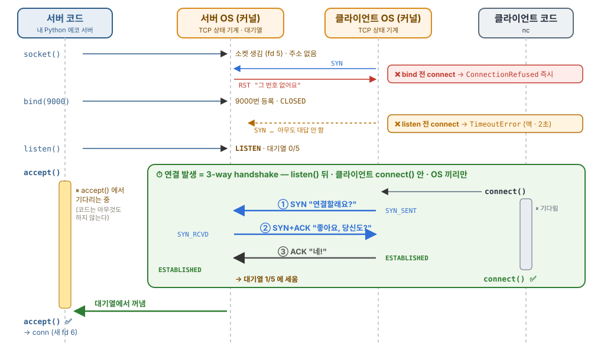

---

## 과제) 에코 서버로 보는 전체 구조 (2)

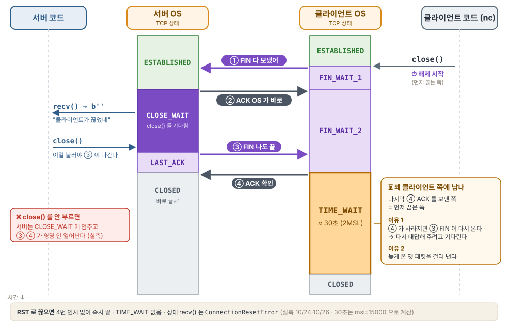

---

## 연결 시작부터 끝까지

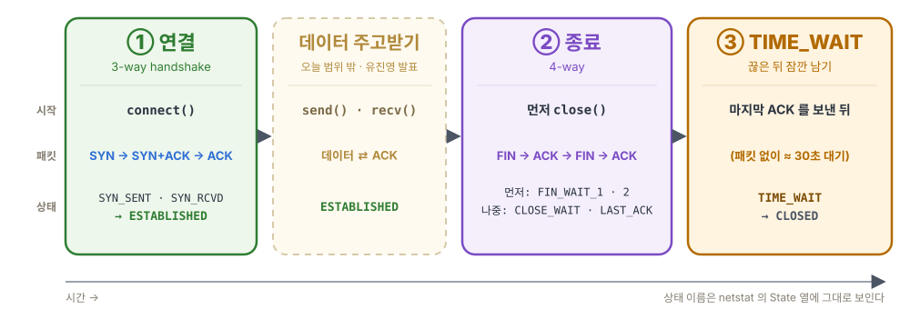

> 오늘 볼 것: 각 단계에서 **무엇이 시작시키고, 어떤 패킷이 오가고, 어떤 상태를 거치나**

---

## 3-way handshake · 왜 필요할까?

---

## 3-way handshake · 왜 필요할까?

> **A. TCP 가 연결 지향 · 신뢰성 프로토콜이기 때문이다.**
> 빠짐없이, 순서대로 보내려면 데이터를 보내기 전에 서로 연결을 확인해야 한다.

TCP 는 **빠짐없이, 순서대로** 보내는 프로토콜이고, 이를 위해 3-way handshake 로 상대가 **받을 수 있는 상황인지** 먼저 파악한다.

참고로 UDP 는 핸드 쉐이크 없이 그냥 데이터를 보낸다.

---

<style scoped>h2{font-size:30px;margin:0 0 8px} img{display:block;margin:0 auto} p{text-align:center}</style>

## 3-way handshake · 0/4 시작 — 클라이언트 CLOSED · 서버 LISTEN

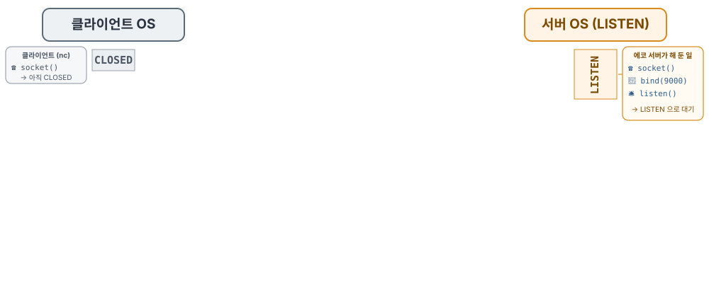

---

<style scoped>h2{font-size:30px;margin:0 0 8px} img{display:block;margin:0 auto} p{text-align:center}</style>

## 3-way handshake · 1/4 ① 클라이언트 connect() → SYN

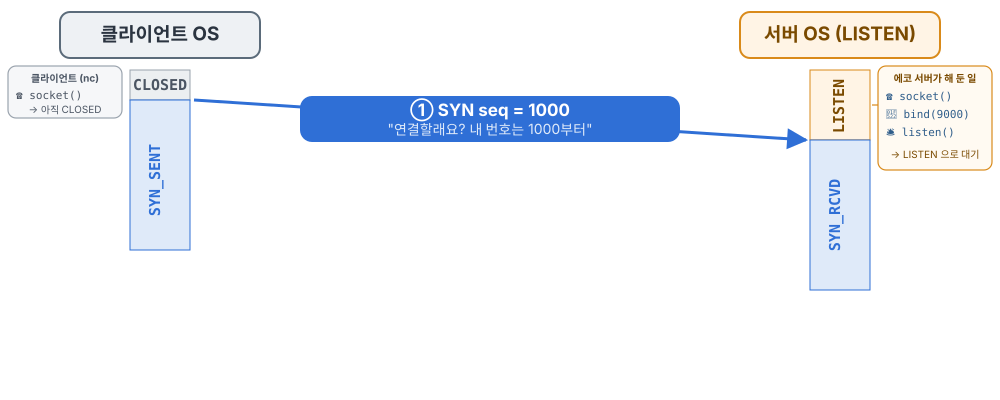

---

<style scoped>h2{font-size:30px;margin:0 0 8px} img{display:block;margin:0 auto} p{text-align:center}</style>

## 3-way handshake · 2/4 ② 서버 OS 가 바로 SYN+ACK

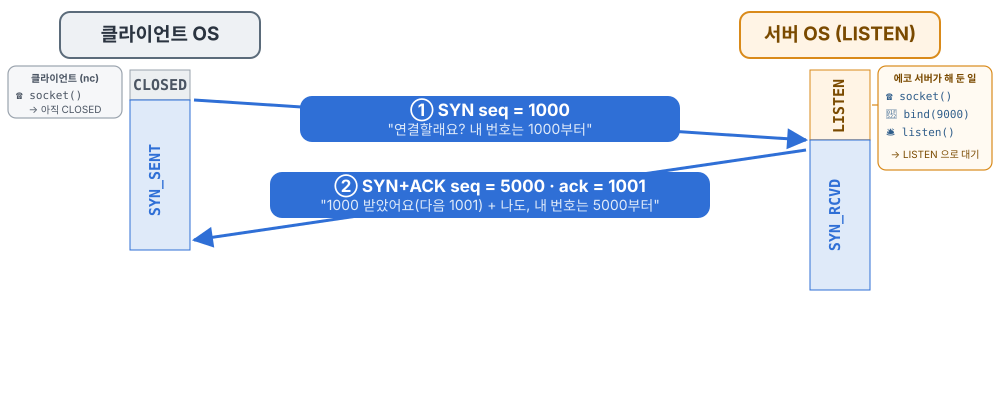

---

<style scoped>h2{font-size:30px;margin:0 0 8px} img{display:block;margin:0 auto} p{text-align:center}</style>

## 3-way handshake · 3/4 ③ 클라이언트 ACK → 양쪽 ESTABLISHED

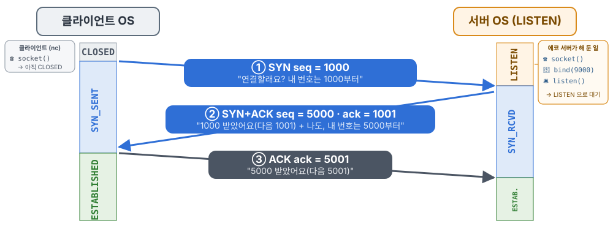

---

<style scoped>h2{font-size:30px;margin:0 0 8px} img{display:block;margin:0 auto} p{text-align:center;font-size:16px;color:#857e72}</style>

## 3-way handshake · 4/4 정리 — seq · ack 번호 규칙

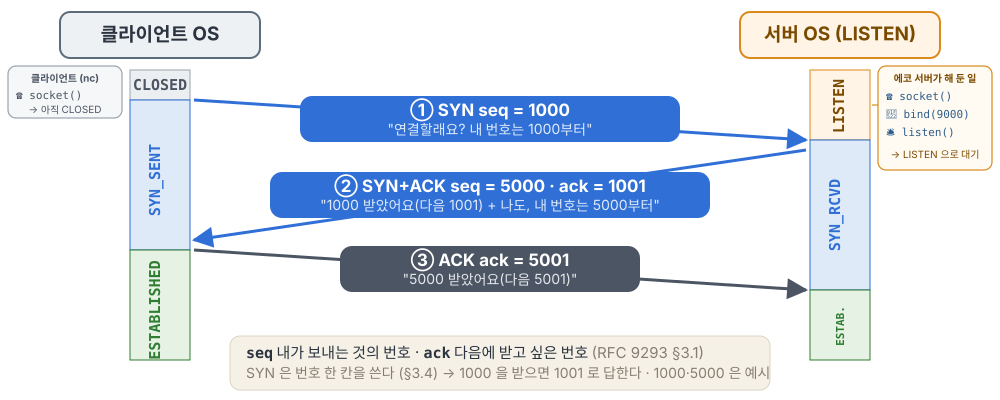

출처: [RFC 9293 §3.1 Header Format](https://www.rfc-editor.org/rfc/rfc9293.html#section-3.1) — ack = 다음에 받고 싶은 번호 · [§3.4 Sequence Numbers](https://www.rfc-editor.org/rfc/rfc9293.html#section-3.4) — SYN·FIN 은 번호 한 칸을 쓴다

---

<style scoped>pre{font-size:26px}</style>

## 호기심) SYN 이 1000 으로 왔는데, 왜 ack 는 1001 일까?

```
① SYN       seq = 1000              "연결할래요? 내 번호는 1000부터"
② SYN+ACK   seq = 5000 · ack = 1001  "1000 받았어요(다음 1001) + 나도, 5000부터"
```

- 1000 을 받았으면 ack=1000 이라고 답해야 할 것 같은데, 왜 **1001** 일까?
- 궁금해서 TCP 표준 문서(**RFC 9293**)를 찾아봤다

---

<style scoped>blockquote,p,li{font-size:20px} .why{margin-top:10px;background:#1c1b19;color:#fff;border-radius:12px;padding:10px 16px;font-size:21px} .why b{color:#ffe7a0}</style>

## 다음에 받고 싶은 번호는 TCP 헤더의 ack 칸에 담겨 전달된다

> **Acknowledgment Number:** 32 bits
>
> If the ACK control bit is set, this field contains the value of the **next sequence number the sender of the segment is expecting to receive**. Once a connection is established, this is always sent.

**쉽게 말하면**

- **ACK 스위치가 켜져 있을 때(받은 요청이 있을떄)만** 헤더 내부 ACK 비트를 확인한다.
- 이 칸에는 **받은 마지막 번호 + 1** 이 들어간다 = "다음엔 이 번호부터 보내 줘"
- 연결이 맺어진 뒤에는 **모든 패킷에** 이 값이 같이 실려 간다

`ack=1001` → "1000까지 받았어, 다음은 1001부터"

**SYN 도 번호 한 칸(1000번)을 차지한다** → 받은 마지막 번호 1000 + 1 = **1001** · [RFC 9293 §3.4](https://www.rfc-editor.org/rfc/rfc9293.html#section-3.4)

<div class="why">💡 <b>그래서 왜 중요한가</b> — 보내는 쪽은 ack 번호로 <b>"어디까지 도착했는지"</b>를 알고, <b>빠진 부분만 다시 보낸다.</b> 이것이 TCP 의 <b>신뢰성(빠짐없이 · 순서대로)</b>을 지키는 방법이다.</div>

---

## 3-way handshake · 그 밖에 알아 둘 것

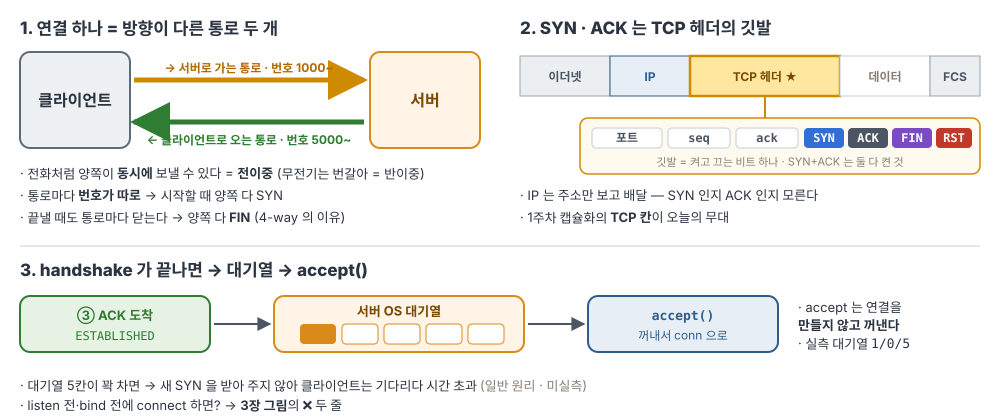

---

<style scoped>blockquote{font-size:22px}</style>

## 4-way handshake · 왜 필요할까?

> **A. TCP 가 양방향 · 신뢰성 프로토콜이기 때문이다.**
> 보내던 데이터를 잃지 않고 끊으려면, 양쪽이 각자 "다 보냈다"를 알리고 확인받아야 한다.

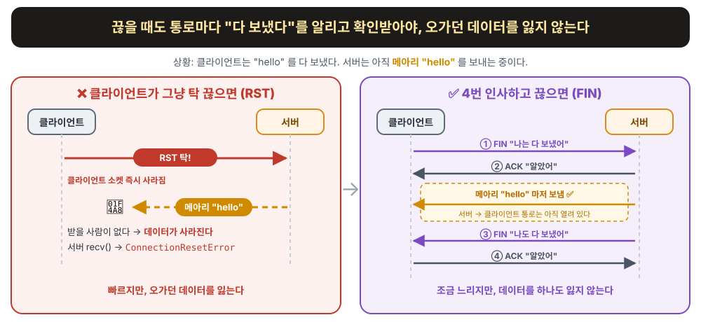

---

<style scoped>h2{font-size:30px;margin:0 0 8px} img{display:block;margin:0 auto} p{text-align:center}</style>

## 4-way handshake · 0/6 시작 — 둘 다 ESTABLISHED

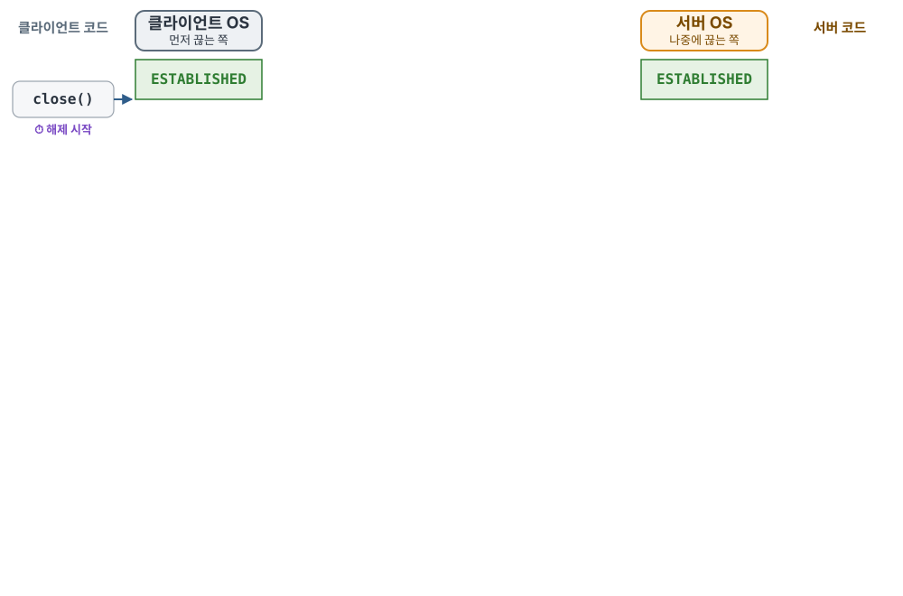

---

<style scoped>h2{font-size:30px;margin:0 0 8px} img{display:block;margin:0 auto} p{text-align:center}</style>

## 4-way handshake · 1/6 ① 클라이언트 close() → FIN

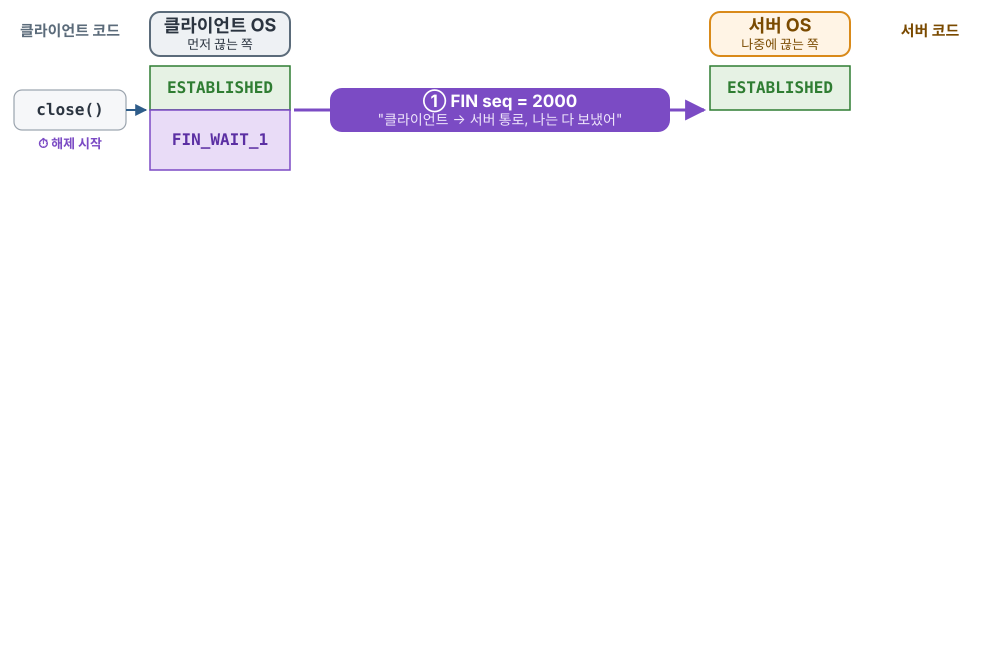

---

<style scoped>h2{font-size:30px;margin:0 0 8px} img{display:block;margin:0 auto} p{text-align:center}</style>

## 4-way handshake · 2/6 ② 서버 OS 가 바로 ACK

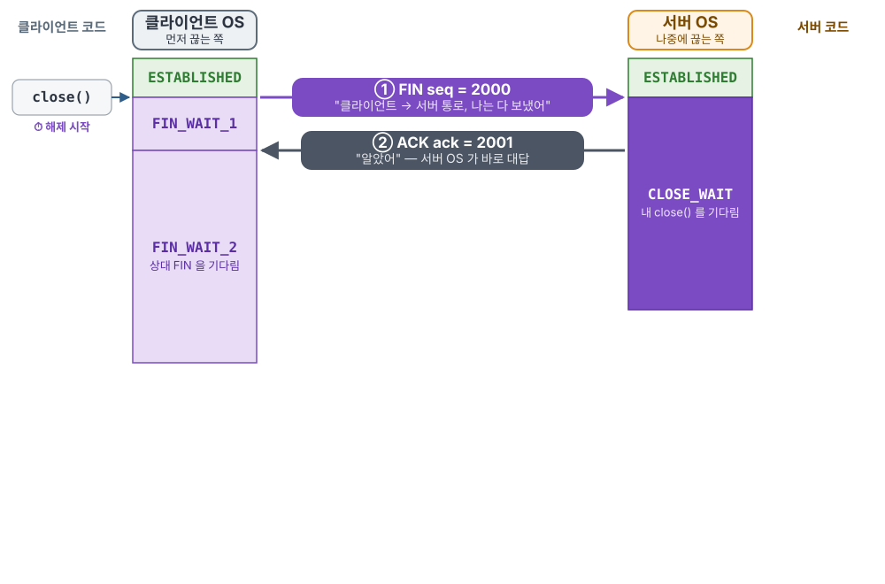

---

<style scoped>h2{font-size:30px;margin:0 0 8px} img{display:block;margin:0 auto} p{text-align:center}</style>

## 4-way handshake · 3/6 half-close — 서버는 아직 보낼 수 있다

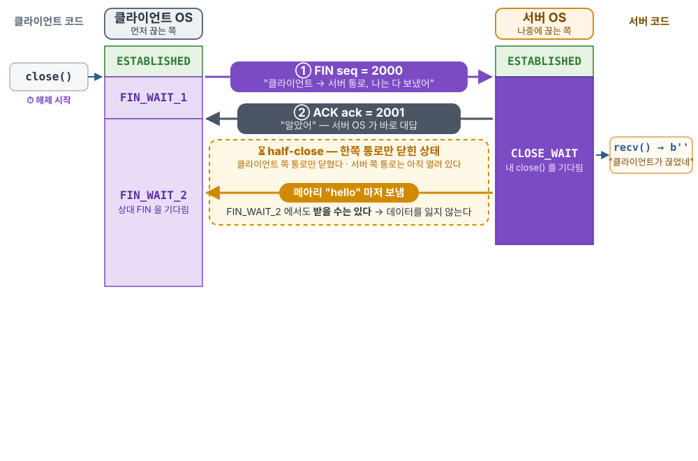

---

<style scoped>h2{font-size:30px;margin:0 0 8px} img{display:block;margin:0 auto} p{text-align:center}</style>

## 4-way handshake · 4/6 ③ 서버 코드 close() → FIN

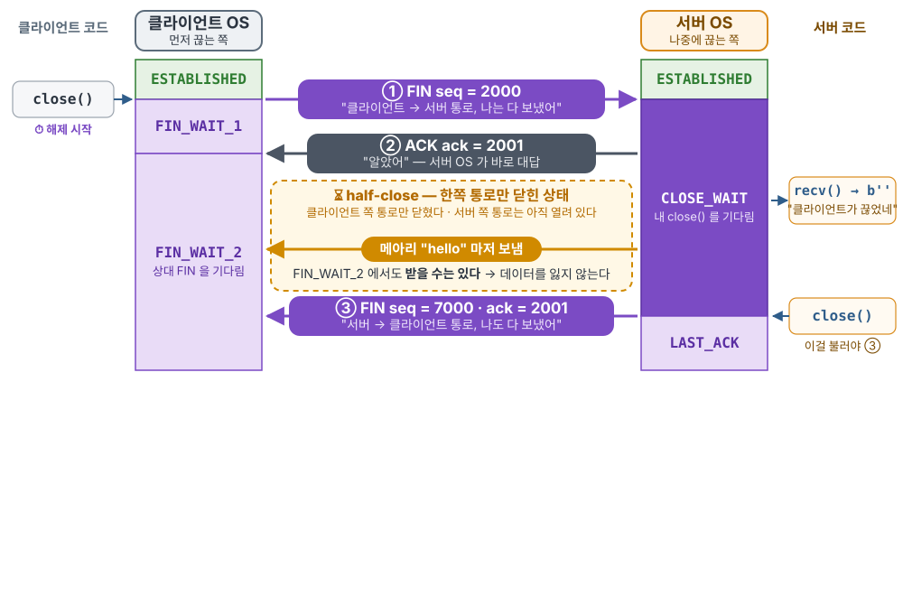

---

<style scoped>h2{font-size:30px;margin:0 0 8px} img{display:block;margin:0 auto} p{text-align:center}</style>

## 4-way handshake · 5/6 ④ 마지막 ACK → 클라이언트 TIME_WAIT

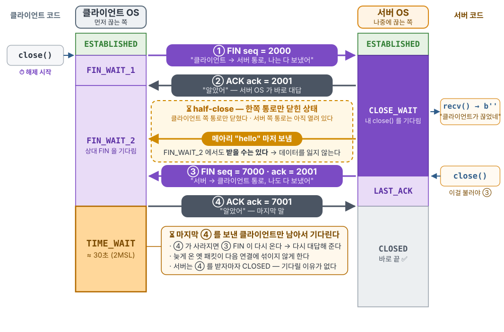

---

<style scoped>h2{font-size:30px;margin:0 0 8px} img{display:block;margin:0 auto} p{text-align:center}</style>

## 4-way handshake · 6/6 끝 — 잠시 후 클라이언트도 CLOSED

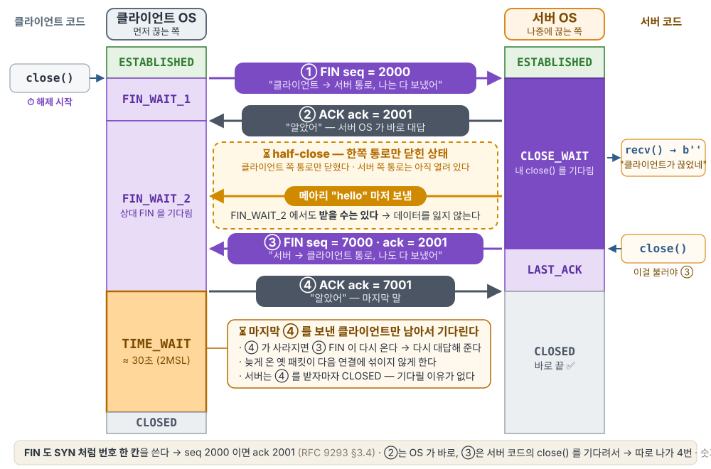

---

<style scoped>h2{font-size:30px;margin:0 0 6px} img{display:block;margin:0 auto} li{font-size:19px}</style>

## 확인해보시죠: close 를 안 하면 CLOSE_WAIT 에 멈춘다

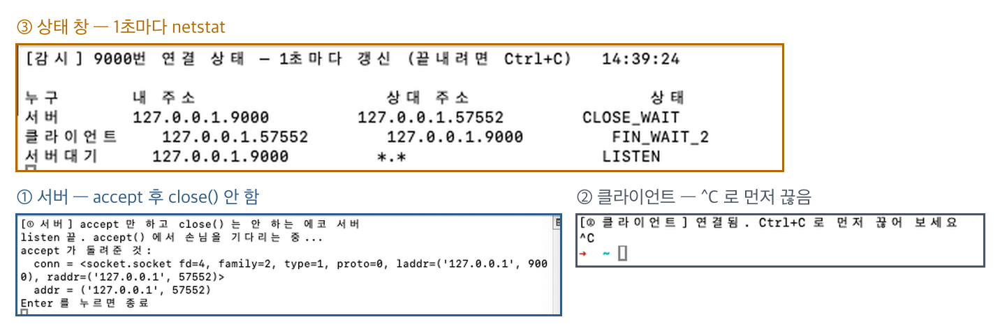

- 클라이언트가 먼저 끊음(`^C`) → 서버 `CLOSE_WAIT` · 클라이언트 `FIN_WAIT_2` — **4-way 가 반에서 멈춤**
- 서버 코드는 `close()` 를 안 부름 → ③ FIN 이 나가지 않는다
- 약 60초 뒤 둘 다 사라짐 (`fin_timeout = 60000ms`) — 하지만 서버 안의 소켓은 남아 `send` → **Broken pipe**
- → ③ FIN 은 **OS 가 대신 보내 주지 않는다.** 보낼 게 남았는지는 내 코드만 알기 때문에, **`close()` 로 직접 알려야 한다**

---

<style scoped>li{font-size:30px;margin:16px 0}</style>

## ③ TIME_WAIT: 왜 먼저 끊은 쪽에 남을까?

마지막 ④ ACK 를 보낸 쪽이 **약 30초** 남는다

1. **다시 대답하려고** — ④ 가 사라지면 ③ FIN 이 다시 온다
2. **옛 패킷을 거르려고** — 같은 조합의 새 연결에 섞이지 않게

---

<style scoped>li{font-size:26px;margin:10px 0} pre{font-size:22px}</style>

## 얼마나 기다리나: 2MSL

- **MSL** = **M**aximum **S**egment **L**ifetime — 패킷 하나가 네트워크에 살아 있을 수 있는 최대 시간
- **왜 2배?** ④ ACK 가 가는 데 1번 + 사라졌다면 ③ FIN 이 다시 오는 데 1번

```
클라이언트 ── ④ ACK ──────────▶ 서버      1 MSL
클라이언트 ◀────────── ③ FIN ── 서버      1 MSL  (④ 가 사라졌을 때)
```

- **이 맥에서는** `msl = 15000ms` → 2MSL ≈ **30초** (OS 마다 다르다)
- 기다리는 건 **커널**이다 — 내 프로그램이 꺼져도 남는다

---

<style scoped>h2{font-size:30px;margin:0 0 10px} h3{font-size:22px;margin:14px 0 4px} pre{font-size:19px;margin:0} li{font-size:22px} img{display:block;margin:0 auto}</style>

## 확인해보시죠: 누가 먼저 끊었나 → TIME_WAIT 위치

### 장면 1 · 클라이언트가 먼저 끊음 (`nc` 에서 `^C`)

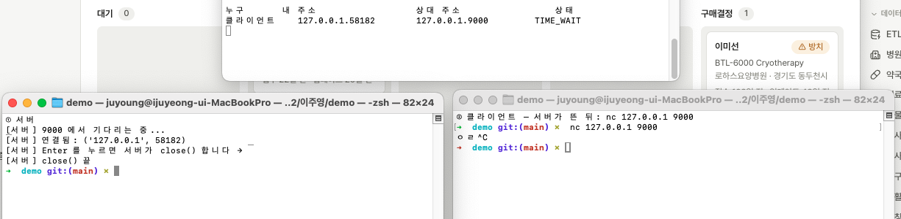

### 장면 2 · 서버가 먼저 끊음 (서버 코드 `close()`)

```
서버        127.0.0.1.9000     127.0.0.1.58217     TIME_WAIT

$ python3 timewait_server.py          ← 30초 안에 다시 켜면
OSError: [Errno 48] Address already in use
```

- 두 장면 모두 **약 30초 뒤 사라짐** — 2MSL 계산과 같다 (10/27 실측)
- `SO_REUSEADDR` = "TIME_WAIT 가 남아 있어도 이 포트로 다시 bind 하게 해 줘"

---

<style scoped>li{font-size:30px;margin:14px 0} blockquote{font-size:28px;margin-top:30px}</style>

## 정리

1. **TCP 는 OS 가 한다** — 내 코드는 언제 열고 닫을지만 정한다
2. **연결 시작할 때 3번** — 클라이언트 `connect()` → 서버 `accept()` 전에 OS 끼리 끝난다
3. **연결 종료할 때 4번** — 클라이언트가 먼저 끊어도, 서버는 **서버 코드가 `close()` 해야** 끊긴다
4. **TIME_WAIT** — 먼저 끊은 쪽이 **30초** 남는다

> Q. 서버가 먼저 끊으면, 서버에 무엇이 쌓일까?
