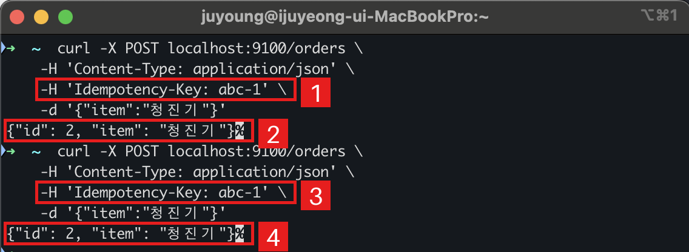
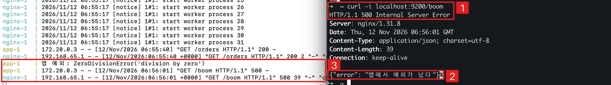
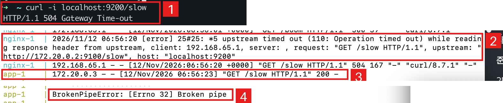

# 과제 C. 멱등 API와 502·504 재현 — 이주영

## 무엇을 만들었나
- `app.py` — Python 표준 라이브러리(`http.server`)만으로 만든 주문 서버
  - `POST /orders`: 같은 `Idempotency-Key` 로 다시 오면 주문을 새로 만들지 않고 처음 응답을 그대로 돌려준다
  - `GET /slow`: 5초 뒤에 응답 (504 재현용)
  - `GET /boom`: 앱 안에서 예외를 내고 500 을 답한다 (500 재현용)
- `nginx.conf` — 앱 앞에 세운 리버스 프록시. `proxy_connect_timeout 2s`, `proxy_read_timeout 2s`
- `docker-compose.yml` — nginx(맥의 9200 포트) → 앱(9100) 두 컨테이너

```bash
docker compose up        # 띄우기
docker compose down      # 내리기
```

## 무엇을 확인했나

- [x] 같은 `Idempotency-Key` 로 `POST /orders` 를 두 번 보내도 주문이 한 번만 만들어진다
  - 같은 키 `abc-1` 로 두 번 보냈고 두 번 다 `id: 2` 가 돌아왔다
  - 
  - 서버 로그: `재시도로 판단 key=abc-1 → 기존 주문 {'id': 2, 'item': '청진기'} 그대로 응답`

- [x] 앱 예외면 500
  - `curl -i localhost:9200/boom` → `HTTP/1.1 500 Internal Server Error`
  - 앱이 직접 500 을 답했고 nginx 에러 로그는 남지 않았다
  - 

- [x] 핸들러 sleep + 짧은 `proxy_read_timeout` 이면 504
  - `curl -i localhost:9200/slow` → `HTTP/1.1 504 Gateway Time-out` (앱은 5초, nginx 는 2초만 기다림)
  - nginx 로그: `upstream timed out (110: Operation timed out) while reading response header from upstream`
  - 앱은 3초 뒤 200 으로 답했지만 받을 곳이 없어 `BrokenPipeError` 가 났다
  - 

- [x] nginx 뒤에서 앱 서버를 끄면 502
  - 앱 프로세스만 죽였을 때 502 가 나왔다 (캡처는 못 남겼고 로그만 있다)

```
$ docker compose exec app pkill python
$ curl -i localhost:9200/orders
HTTP/1.1 502 Bad Gateway
Server: nginx/1.31.8

app-1    | 앱 프로세스 종료됨
nginx-1  | connect() failed (111: Connection refused) while connecting to upstream
```

| 무엇을 껐나 | 명령 | 결과 |
| --- | --- | --- |
| 앱 프로세스만 | `docker compose exec app pkill python` | 502, 0.003초 |
| 앱 컨테이너 통째로 | `docker compose stop app` | 504, 2초 뒤 |

## 데모 순서 (7분)
1. `docker compose up` → 같은 키로 `POST /orders` 두 번 → `id` 가 같은 것 보여 주기
2. `/boom` → 500, `/slow` → 504 (2초 뒤)
3. `docker compose exec app pkill python` → 502
4. `docker compose stop app` → 504 가 나오는 것 보여 주고 "왜 502 가 아닐까?" 질문

## 예상과 달랐던 점
<!-- 본인 문장으로 적기. 재료: "앱 서버를 끄면 502" 라고 했는데 컨테이너를 통째로 끄면 504 가 나왔다 -->
- 
