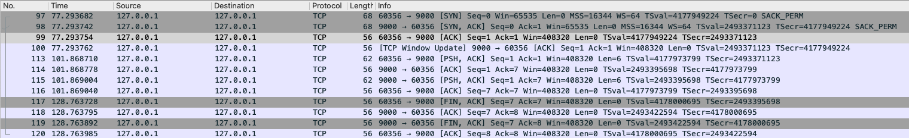
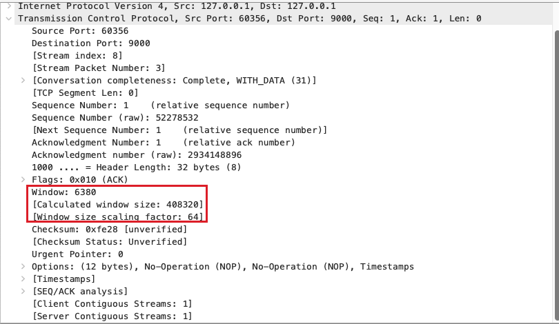
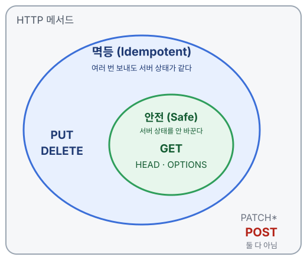

# 3주차 멱등성과 재시도

- 지난 주 복습: 3-way · 4-way, 그리고 TCP 헤더에 있는 Window, MSS(Maximum Segment Size)
- 안전성 vs 멱등성
- 메서드별 멱등성
- 응답을 못 받았을 때, 다시 보내도 될까?
- Idempotency-Key

---

## 지난 주 복습: 3-way · 4-way 를 와이어샤크로



- 과제 A 서버(`127.0.0.1:9000`)에 `nc` 로 붙었다가 종료해보았습니다.
- **97~99** 3-way 로 여는 행 / **113~116** hello 보내고 에코 받기 / **117~120** 4-way 로 닫는 행입니다.

---

## 3-way 로 열고, 4-way 로 닫는다

| 번호 | 방향      | 플래그     | Seq · Ack | 뜻                                      |
| :--: | --------- | ---------- | --------- | --------------------------------------- |
|  97  | nc → 서버 | `SYN`      | 0 · –     | 연결하고 싶어요                         |
|  98  | 서버 → nc | `SYN, ACK` | 0 · **1** | 좋아요, 네 SYN(0번) 받았어              |
|  99  | nc → 서버 | `ACK`      | 1 · 1     | 네 SYN 도 받았어 → 연결 완료            |
| 117  | nc → 서버 | `FIN, ACK` | 7 · 7     | 나 보낼 거 없어 (Ctrl+C)                |
| 118  | 서버 → nc | `ACK`      | 7 · 8     | 알았어                                  |
| 119  | 서버 → nc | `FIN, ACK` | 7 · 8     | 나도 없어 (`recv` 가 빈 값 → `close()`) |
| 120  | nc → 서버 | `ACK`      | 8 · 8     | 끝 → **먼저 끊은 nc 에 TIME_WAIT 30초** |

---

## 퀴즈: 99번엔 Seq 1 인데, 117번엔 왜 갑자기 7?

| 번호 | 방향      | 플래그     | Seq · Ack |
| :--: | --------- | ---------- | --------- |
|  99  | nc → 서버 | `ACK`      | **1** · 1 |
|  …   |           |            |           |
| 117  | nc → 서버 | `FIN, ACK` | **7** · 7 |

> 그 사이(113~116번)에 무슨 일이 있었을까?

---

## 답: 그 사이에 `hello` 를 보냈기 때문

| 번호 | 방향      | 플래그     | Seq · Ack | 길이  | 뜻                         |
| :--: | --------- | ---------- | --------- | :---: | -------------------------- |
| 113  | nc → 서버 | `PSH, ACK` | 1 · 1     | **6** | `hello` + 줄바꿈 보냄      |
| 114  | 서버 → nc | `ACK`      | 1 · **7** |   0   | 6바이트 받았어, 다음은 7번 |
| 115  | 서버 → nc | `PSH, ACK` | 1 · 7     |   6   | 에코로 돌려줌              |
| 116  | nc → 서버 | `ACK`      | **7** · 7 |   0   | 에코 받았어                |

- `hello` 5글자 + Enter 줄바꿈 1 = **6바이트** → 번호 1~6 을 쓰고, 다음 번호가 **7**
- Seq 는 **보낸 데이터 바이트만큼** 늘어난다. 빈 ACK(길이 0)는 번호를 안 쓴다

---

## 99번 패킷을 펼치면: 진짜 TCP 헤더



- `Window: 6380` 은 헤더 값, `[Calculated window size: 408320]` 은 × 64 한 값

---

## MSS 와 Window

|                 | MSS                        | Window                            |
| --------------- | -------------------------- | --------------------------------- |
| 한 줄로         | 상자 **하나**의 최대 크기  | 받는 쪽 창고의 **빈 자리**        |
| TCP 헤더 어디에 | **옵션** 칸 — SYN 패킷에만 | **기본** 칸(16비트) — 모든 패킷에 |
| 캡처 값         | `16344`                    | `6380 × 64 = 408320`              |
| 어느 제어?      | **둘 다 아님** — 크기 단위 | **흐름 제어** (= rwnd)            |

**왜 × 64?** Window 칸은 16비트 = 2¹⁶ → 최대 **65,535** 까지만 적힌다. 그래서 SYN 때 `WS=64`(2⁶) 로 "적힌 값에 64 곱해 읽어"라고 약속한다. SYN 두 개는 약속 전이라 `65535` 그대로

---

## 같이 고민해 보기

1. `GET /posts/1` 을 100번 보내면 서버에 무슨 일이 생길까?
2. `DELETE /posts/1` 을 두 번 보내면? 두 번째 응답은 무엇일까?
3. `POST /orders` 를 두 번 보내면?
4. "다시 보내도 안전하다"는 걸 **무엇을 보고** 판단할까?

---

## 먼저 단어 두 개: 안전성과 멱등성



- **안전**: 호출해도 서버 상태를 **안 바꾼다**
- **멱등**: 여러 번 보내도 서버 상태가 **같다**
- 안전 ⊂ 멱등
  - 안전하면 → 항상 멱등 (GET)
  - 멱등이어도 → 안전하지 않을 수 있다 (PUT·DELETE)
- "결과"는 **응답이 아니라 서버의 상태**, "안전"은 보안이 아니라 **데이터를 안 바꾼다**는 뜻

---

## 메서드별로 보면

| 메서드 | 안전 |    멱등     | 두 번 보내면 서버 상태                          |
| ------ | :--: | :---------: | ----------------------------------------------- |
| GET    |  ✅  |     ✅      | 그대로                                          |
| PUT    |  ❌  |     ✅      | 같은 값으로 **덮어쓴** 상태                     |
| DELETE |  ❌  |     ✅      | **지워진** 상태 (두 번째 응답은 404 일 수 있다) |
| POST   |  ❌  |     ❌      | 리소스가 **하나 더** 생긴다                     |
| PATCH  |  ❌  | 설계에 따라 | `age=20` 은 멱등, `age+1` 은 아님               |

- 정본: RFC 9110 §9.2 — "PUT, DELETE, 그리고 안전한 메서드는 멱등이다"
- PATCH 는 RFC 5789 가 **멱등을 보장하지 않는다**고 할 뿐, "멱등이면 안 된다"는 아니다

---

## PUT 과 POST 의 차이: "여기를 이걸로" vs "이걸 처리해 줘"

```
PUT  /members/100  { name: "주영" }   → "100번 회원을 통째로 이걸로 바꿔"
POST /members      { name: "주영" }   → "이 데이터로 회원 하나 만들어 줘" (번호는 서버가)
```

| 두 번 보내면 | PUT                                     | POST                      |
| ------------ | --------------------------------------- | ------------------------- |
| 서버 상태    | 100번 회원 **1명** (같은 값으로 덮어씀) | 101번, 102번 회원 **2명** |
| 멱등?        | ✅                                      | ❌                        |

- 주소 모양이 아니라 **메서드의 뜻**이 다르다 — `POST /members/100` 도 가능하지만 뜻은 "100번에게 이걸 처리시켜" 라서 여전히 멱등을 약속하지 않는다

---

## 멱등이 깨지는 설계

| 겉으로는                       | 실제 동작                 | 점검할 것                                          |
| ------------------------------ | ------------------------- | -------------------------------------------------- |
| `DELETE /posts/last`           | 매번 **마지막** 글을 지움 | 대상을 **정확한 ID** 로 가리키나?                  |
| `PATCH /users/1 { age: "+1" }` | 15 → 16 → 17              | **"얼마로"** 를 보내나, **"얼마나 더"** 를 보내나? |
| `GET /posts/1` 에서 조회수 +1  | 볼 때마다 숫자 증가       | GET 이 **데이터를 바꾸나?**                        |

> 우리 서비스: 개원정보 글 조회수는 **GET 에서 올리다가 `POST /:slug/view` 로 떼어냈다**
> (`get-public-article.use-case.ts` — "조회수를 올리지 않는다. 한때 여기서 올렸는데…")

---

## 그래서: 응답을 못 받았을 때 다시 보내도 되나

```
요청이 닿았는지 모른다
   ├─ 멱등한 요청 (GET · PUT · DELETE)  → 다시 보내도 된다. 결과 상태가 같으니까
   └─ 멱등하지 않은 요청 (POST)          → 그냥 다시 보내면 중복될 수 있다
```

- RFC 9110 §9.2.2: 클라이언트는 멱등하지 않은 요청을 **자동으로 재시도하지 않아야 한다(SHOULD NOT)**
- 그래서 브라우저는 연결이 끊긴 **GET 은 몰래 다시 보내지만**, POST 는 묻는다 — 결제 직후 새로고침하면 뜨는 **"양식 다시 제출하시겠습니까?"** 경고가 이것

> 그럼 결제·주문처럼 POST 인데 재시도가 꼭 필요하면?

---

## Idempotency-Key: POST 를 멱등하게 만드는 법

```
1) 클라이언트가 요청마다 고유 키를 만든다          key = 3fa8...
2) POST /orders  Idempotency-Key: 3fa8...      → 서버: 처음 보는 키 → 주문 생성, 키 기록
3) (응답이 끊겨서) 같은 키로 다시 보낸다          → 서버: 이미 처리한 키 → 새로 안 만들고 같은 결과 반환
```

- 키는 **클라이언트가** 만든다 — "이건 같은 요청이야"를 아는 건 보내는 쪽이기 때문
- 서버는 **키를 기억**해야 한다 (DB 유니크 제약 등)
- 토스페이먼츠·Stripe 같은 결제 API 가 이 방식이다

---

## 실제 예: 토스페이먼츠 결제 API

```
POST /v1/payments/confirm
Idempotency-Key: 3fa8...      ← UUID, 15일 동안 유효
```

| 상황                             | 토스의 응답                          |
| -------------------------------- | ------------------------------------ |
| 같은 키로 또 옴                  | 다시 처리 안 함 → **첫 응답 그대로** |
| 첫 요청이 아직 처리 중인데 또 옴 | **409** "이전 요청 처리 중"          |
| 에러 났다고 키를 바꿔 재시도     | ⚠️ 위험 — 새 요청으로 처리될 수 있다 |

[토스페이먼츠 문서 — 멱등키 헤더](https://docs.tosspayments.com/reference/using-api/authorization)

---

## 정리

| 질문                          | 답                                                              |
| ----------------------------- | --------------------------------------------------------------- |
| 멱등이란                      | 여러 번 보내도 **서버 상태**가 한 번 보낸 것과 같다             |
| 다시 보내도 되는 요청         | GET · PUT · DELETE (멱등)                                       |
| POST 를 안전하게 재시도하려면 | **Idempotency-Key** — 클라이언트가 키를 만들고, 서버가 기억한다 |

- 다음 주 과제 C: 이 키를 직접 구현하고, nginx 로 502·504 를 재현한다
