# 4주차 HTTP/1.1 / 2 / 3

1. 지난 주 과제 C 돌아보기
2. 오늘의 질문
3. HTTP/1.1: 요청을 한 번에 하나씩
4. HTTP/2: 요청을 한꺼번에
5. HTTP/3: TCP 를 버리고 UDP 로
6. 우리 서비스에서는

---

<!-- header: '**1 과제 C** › 2 질문 › 3 HTTP/1.1 › 4 HTTP/2 › 5 HTTP/3 › 6 우리 서비스' -->

## 1.1 지난 주 과제 C 한눈에

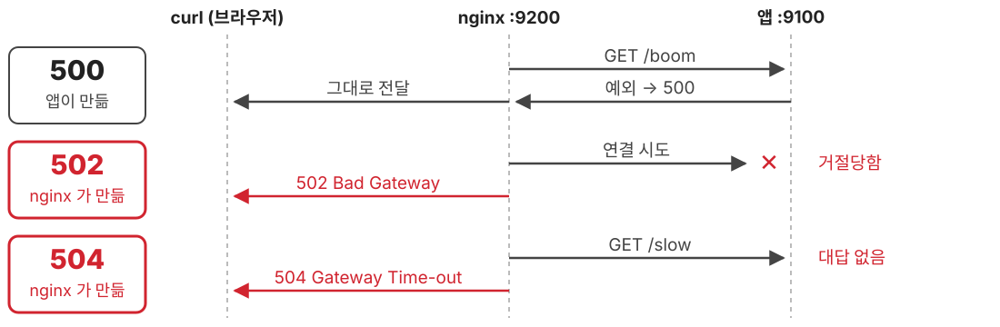

**거절당하면 502, 대답이 없으면 504** — 진영님 3주차 발표에서 배웠어요 ([진영님 과제](https://github.com/opngroup/network-study-2026/tree/main/week-03/유진영/assignment-c) · [내 과제](https://github.com/opngroup/network-study-2026/tree/main/week-03/이주영/assignment-c))

---

## 1.2 같은 키로 두 번 보내면?

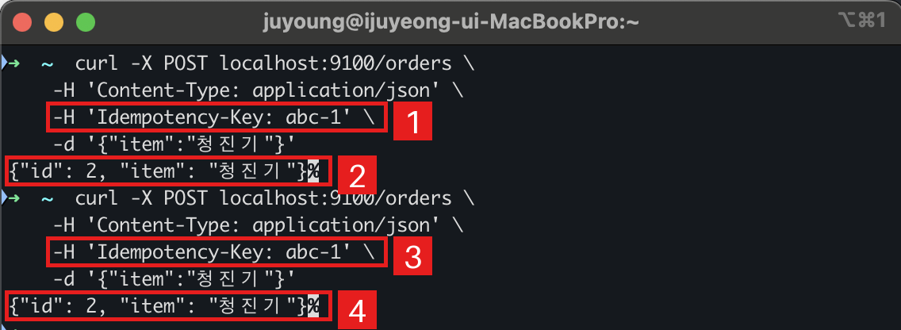

- **1·3** 같은 키(`Idempotency-Key: abc-1`)로 주문을 두 번 보냈어요
- **2·4** 두 번 다 `id: 2` 가 왔어요. 주문은 한 번만 만들어졌어요

---

<!-- header: '1 과제 C › **2 질문** › 3 HTTP/1.1 › 4 HTTP/2 › 5 HTTP/3 › 6 우리 서비스' -->

# 2. HTTP/1.1 · 2 · 3, 그게 뭐가 중요해?

어차피 요청 보내고 응답 받는 건 똑같잖아요.

```
브라우저 ──HTTP/2──▶ Vercel ──▶ Next.js ──HTTP/1.1──▶ ALB ──HTTP/1.1──▶ NestJS
```

그런데 우리 서비스는 **구간마다 HTTP 버전이 달라요**. 왜 그럴까요?

---

## 2.1 오늘의 흐름: 문제 → 해결 → 새 문제

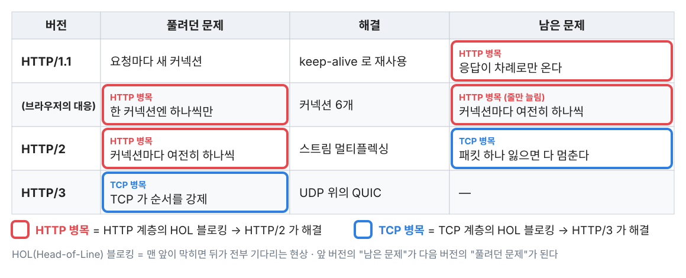

---

<!-- header: '1 과제 C › 2 질문 › **3 HTTP/1.1** › 4 HTTP/2 › 5 HTTP/3 › 6 우리 서비스' -->

## 3.1 HTTP/1.1 (1997): 커넥션은 다시 쓰지만, 응답은 한 줄로

- 커넥션 하나를 계속 다시 써요 (keep-alive, 2주차 과제 B 에서 재 봤어요)
- 그런데 응답에 **번호표가 없어요**. 그래서 요청한 순서대로만 답할 수 있어요
- 앞 응답이 늦으면 뒤 응답이 다 기다려요. 이게 **HTTP 병목** (HOL 블로킹) 이에요

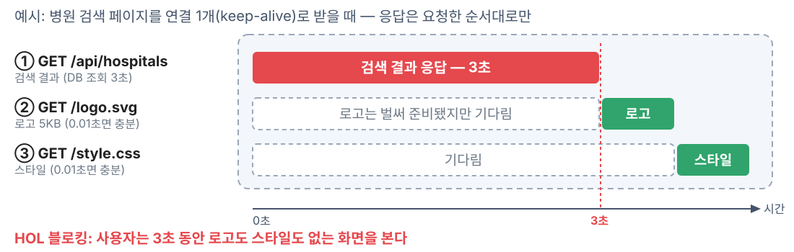

---

## 3.2 브라우저의 대응 (2008): 도메인당 커넥션 2개 → 6개

```
문제   커넥션 하나로는 한 번에 하나씩만 받아요 (응답에 번호표가 없어서)
대응   그럼 커넥션을 여러 개 열자 → 원래 2개, 2008년부터 6개 (IE8 · Firefox 3)
```

여기서 두 가지를 볼게요

- **3.2.1** 왜 하필 6개일까?
- **3.2.2** 덤으로 얻은 것: 웹 페이지 성능

출처: [RFC 2616 §8.1.4](https://www.rfc-editor.org/rfc/rfc2616#section-8.1.4) · [Steve Souders 2008](https://www.stevesouders.com/blog/2008/03/20/roundup-on-parallel-connections/)

---

## 3.2.1 왜 하필 6개일까?

| 커넥션    | 빠르기             | 비용                                  |
| --------- | ------------------ | ------------------------------------- |
| 2개       | 느려요             | 적어요                                |
| **6개**   | **꽤 빨라요**      | **버틸 만해요 ← 브라우저들이 고른 곳** |
| 60개      | 더 빨라질까?       | 핸드셰이크 60번 · 서버가 공격으로 보고 막아요 |

- 많이 열수록 **동시에 많이 받지만**, 많이 열수록 **비싸요** (근거 ① ② ③)
- 그 사이에서 6 근처로 맞췄어요. **정확히 왜 6인지는 근거를 못 찾았어요**

---

## 3.2.1 근거 ①: 커넥션을 여는 건 비싸요

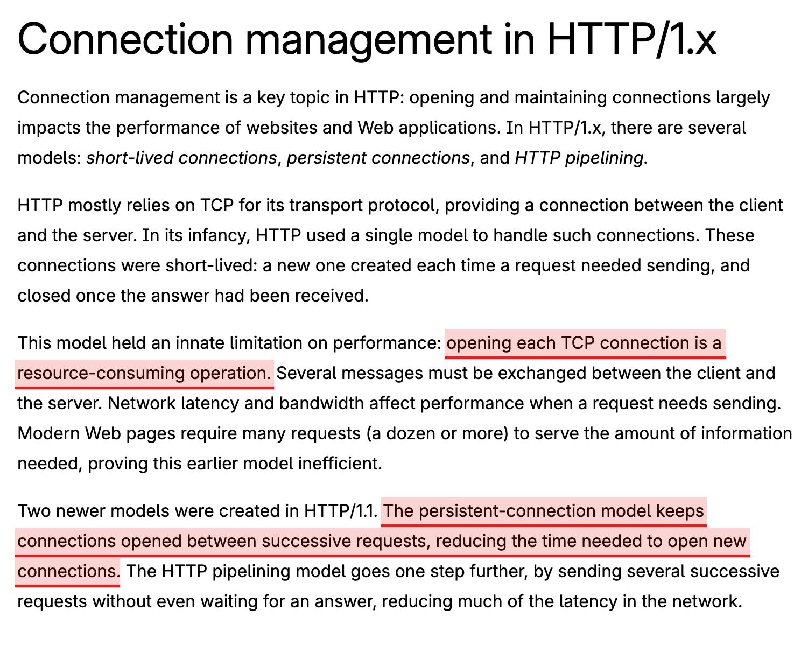

- **TCP 커넥션을 여는 것부터 비용**이에요. 메시지를 여러 번 주고받아야 해요
- 그래서 HTTP/1.1 은 **커넥션을 열어 둬요** (keep-alive)
- 커넥션을 늘리는 게 공짜가 아닌 이유예요

[MDN: Connection management in HTTP/1.x](https://developer.mozilla.org/en-US/docs/Web/HTTP/Guides/Connection_management_in_HTTP_1.x)

---

## 3.2.1 근거 ②: 직접 재 봤어요

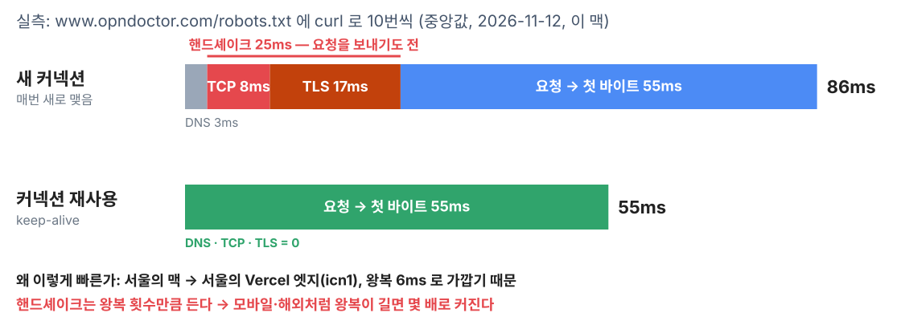

```
curl -s -o /dev/null -o /dev/null -w 'TCP %{time_connect}s TLS %{time_appconnect}s 새연결 %{num_connects}\n' \
  https://www.opndoctor.com/robots.txt https://www.opndoctor.com/robots.txt
```

---

## 3.2.1 근거 ③: 커넥션을 너무 많이 열면

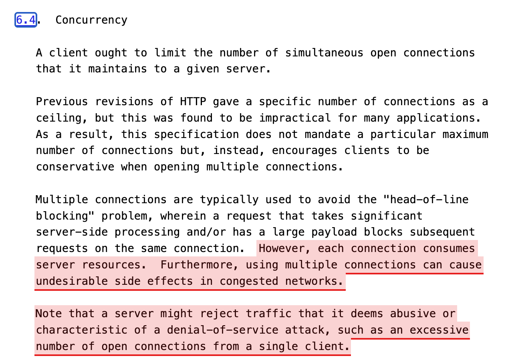

- 커넥션마다 **서버 자원을 써요**
- 붐비는 망에서는 **오히려 더 막혀요**
- 너무 많이 열면 서버가 **공격(DoS)으로 보고 막아요**

[RFC 7230 §6.4 Concurrency](https://www.rfc-editor.org/rfc/rfc7230#section-6.4)

---

## 3.2.2 덤: 웹 페이지 성능도 좋아졌어요

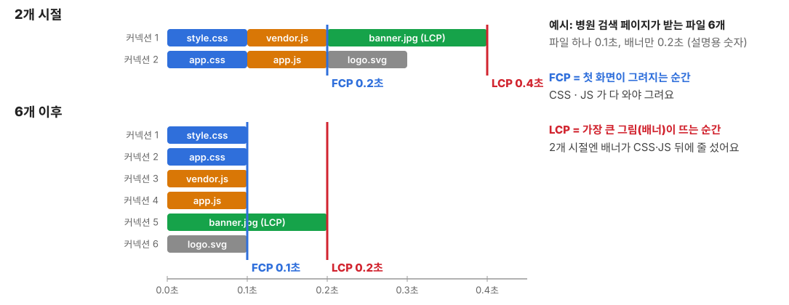

커넥션을 늘린 **덤으로 FCP · LCP 가 빨라졌어요** (INP · CLS 는 네트워크와 무관해서 그대로)

---

## 3.3 프론트 최적화 기법 잠깐 공유: 번들링 · 아이콘 스프라이트

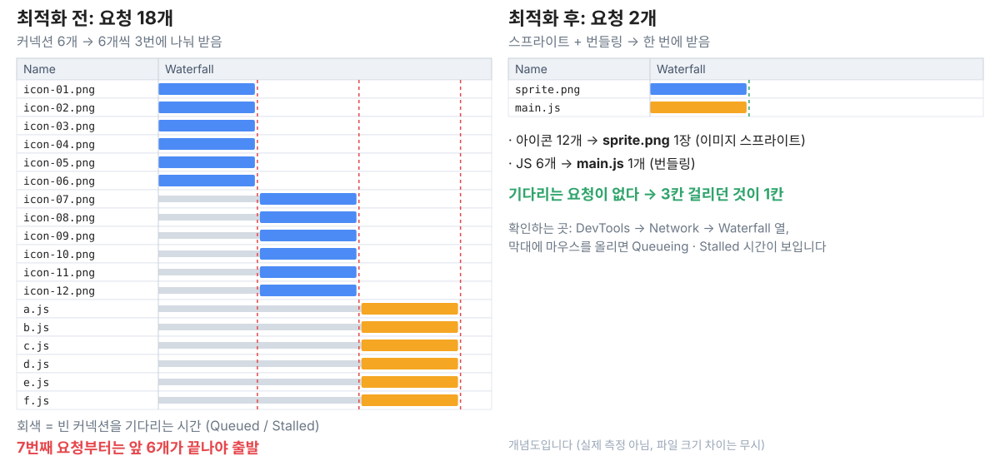

---

<!-- header: '1 과제 C › 2 질문 › 3 HTTP/1.1 › **4 HTTP/2** › 5 HTTP/3 › 6 우리 서비스' -->

## 4.1 HTTP/2 (2015): 커넥션 하나로 요청을 한꺼번에

- **4.1.1** 구글이 만든 SPDY 에서 시작했어요
- **4.1.2** 요청과 응답을 **프레임**으로 잘게 쪼개고 **스트림 번호**를 붙여요. 번호표가 생긴 거예요
- **4.1.3** 응답이 섞여서 와도 번호를 보고 다시 맞춰요. 이게 **멀티플렉싱**이에요
- **4.1.4** **HTTP 병목이 사라져요**. 커넥션을 6개씩 열 필요가 없어요

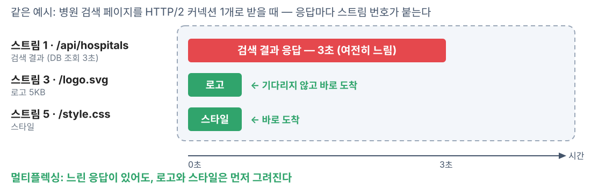

---

## 4.1 프레임 · 스트림 번호 · 멀티플렉싱 한눈에

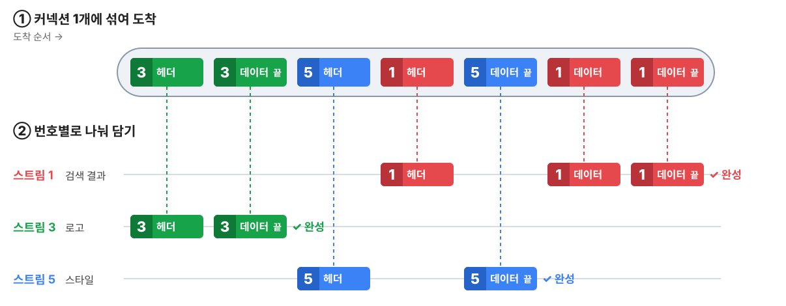

**멀티플렉싱** = 커넥션 하나에 여러 요청의 조각을 **섞어 보내고**, 번호로 **다시 나누는** 것

---

## 4.1.2 더 깊이 ①: 프레임은 이렇게 생겼어요

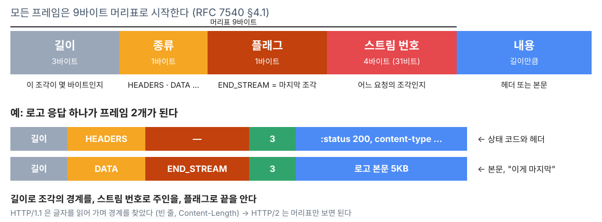

---

## 4.1.3 더 깊이 ②: 스트림 번호를 직접 봤어요

```
$ curl -sv -o /dev/null -o /dev/null https://www.opndoctor.com/robots.txt https://www.opndoctor.com/favicon.ico

* using HTTP/2
* [HTTP/2] [1] OPENED stream for https://www.opndoctor.com/robots.txt
* [HTTP/2] [1] [:method: GET]
* [HTTP/2] [1] [:path: /robots.txt]
< HTTP/2 200
* Re-using existing connection with host www.opndoctor.com
* [HTTP/2] [3] OPENED stream for https://www.opndoctor.com/favicon.ico
* [HTTP/2] [3] [:method: GET]
* [HTTP/2] [3] [:path: /favicon.ico]
< HTTP/2 200
```

- `[1]`, `[3]` 이 **스트림 번호**예요. 브라우저가 여는 스트림은 홀수예요
- `Re-using existing connection` → 커넥션은 **하나**이고, 그 안에 스트림이 둘이에요

---

## 4.2 그래도 남은 병목: TCP 병목

- TCP 는 받은 데이터를 **보낸 순서 그대로** 올려 줘요 (3주차에 본 Seq · Ack)
- 그래서 패킷 하나가 빠지면, 뒤에 온 **다른 스트림의 데이터까지** 기다려요

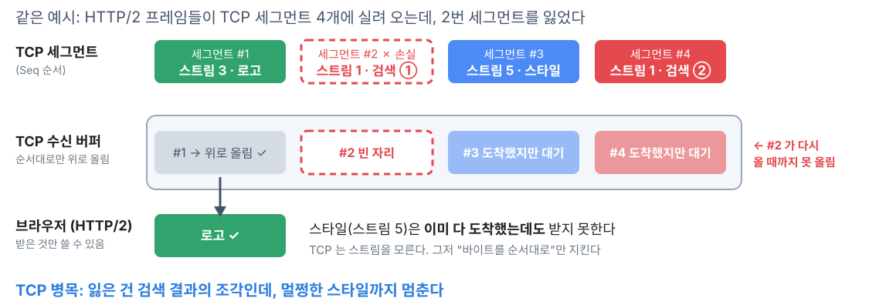

---

## 4.2.1 복습: TCP 는 왜 순서를 지킬까 (3주차 Seq · Ack)

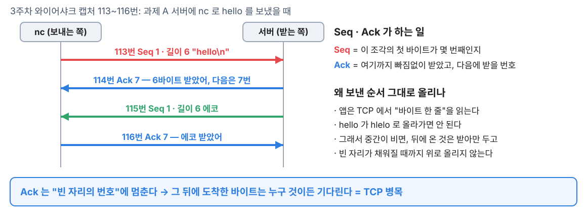

캡처 원본은 [3주차 슬라이드](https://github.com/opngroup/network-study-2026/blob/main/week-03/%EC%9D%B4%EC%A3%BC%EC%98%81/slides.md)에 있어요

---

## 4.3 덤: 이번 달 Apache 에서 터진 HTTP/2 버그

```
스트림 1 → 워커 스레드 A ─┐
스트림 3 → 워커 스레드 B ─┴→ 같은 표에 동시에 씀 (락 없음) → 메모리가 깨짐
```

- Apache 는 스트림마다 **스레드를 나눠서** 처리해요
- 그런데 두 스레드가 **락 없이 같은 표에 썼어요**. 그래서 메모리가 깨졌어요
- 로그인 없이 공격할 수 있어서 위험도가 높아요 (F5 기준 10점 중 9.8점)
- HTTP/2 규격이 아니라 **Apache 코드의 버그**예요. HTTP/1.1 만 켠 서버는 괜찮았어요
- 2.4.71 (2026-11-11) 에서 고쳤어요

출처: CVE-2026-119618 — [F5](https://www.f5.com/labs/articles/cve-2026-119618) · [CovertSwarm](https://www.covertswarm.com/threat-alert/cve-2026-119618-apache-http2-rce) · [The Hacker News](https://thehackernews.com/2026/11/critical-apache-http2-flaw-could-let.html)

---

<!-- header: '1 과제 C › 2 질문 › 3 HTTP/1.1 › 4 HTTP/2 › **5 HTTP/3** › 6 우리 서비스' -->

## 5.1 HTTP/3 (2022): TCP 를 버리고 UDP 위의 QUIC 으로

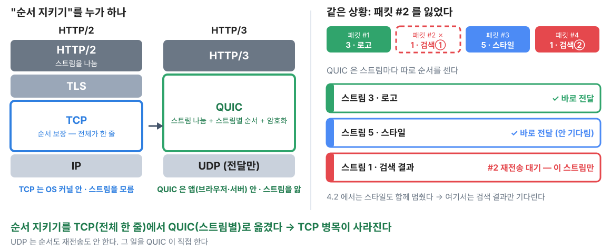

---

## 5.2 HTTP/3 는 TCP 를 안 타요

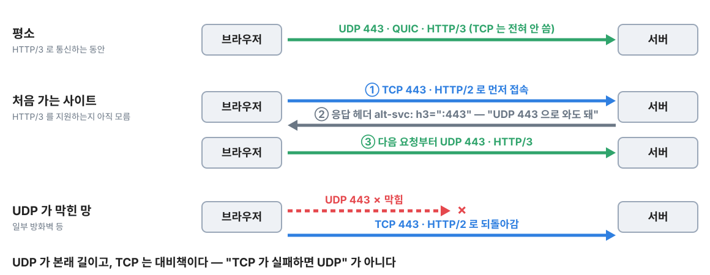

- 직접 봤어요: 유튜브 · 구글은 `alt-svc: h3=":443"` 을 보내요. 우리 서비스 · 네이버는 안 보내요

---

## 5.3 왜 TCP 를 안 고치고 새로 만들었을까?

- TCP 는 **OS 안**에 있어요. 바꾸려면 OS 를 업데이트해야 해요
- 방화벽 · 공유기가 **낯선 TCP 를 막아요**
- UDP 는 어디서나 지나가요. 그래서 **브라우저와 서버 프로그램만** 업데이트하면 돼요
- 비유: TCP 는 우체국 등기예요. QUIC 은 일반 우편으로 보내고 규칙은 둘이 직접 챙겨요

---

<!-- header: '1 과제 C › 2 질문 › 3 HTTP/1.1 › 4 HTTP/2 › 5 HTTP/3 › **6 우리 서비스**' -->

## 6.1 버전은 누가 고를까?

- 백엔드 코드는 버전을 몰라도 돼요. 메서드 · 상태 코드 · 헤더의 **뜻은 똑같아요**
- 브라우저와 서버가 **연결할 때 알아서 정해요**
  - HTTP/2: TLS 를 맺을 때 정해요 (ALPN)
  - HTTP/3: 서버가 헤더로 "나 h3 돼요" 하고 알려 줘요 (`alt-svc`)

---

## 6.2 우리 서비스에서는

| 구간                         | 버전     | 어떻게 알았나                     |
| ---------------------------- | -------- | --------------------------------- |
| 브라우저 → Vercel            | HTTP/2   | 직접 쟀어요 (`ALPN: h2`)          |
| Next.js → ALB                | HTTP/1.1 | 추정이에요 (옵션 없는 `fetch`)    |
| ALB → NestJS                 | HTTP/1.1 | 설정에서 봤어요 (keep-alive 65초) |
| 브라우저 → CloudFront 이미지 | HTTP/2   | 직접 쟀어요                       |

```
curl -sv -o /dev/null https://www.opndoctor.com/ 2>&1 | grep ALPN
curl -sI https://www.opndoctor.com/ | grep -i alt-svc
```

---

## 6.3 그래서, 왜 구간마다 HTTP 버전이 다를까?

```
브라우저 ──HTTP/2──▶ Vercel ──▶ Next.js ──HTTP/1.1──▶ ALB ──HTTP/1.1──▶ NestJS
```

- **브라우저 → 서버**: 파일은 수십 개인데 커넥션은 6개뿐이에요
  → 한 커넥션으로 한꺼번에 받는 **HTTP/2**
- **서버 → 서버**: 6개 제한이 없어요. 커넥션을 여러 개 열면 돼요
  → **HTTP/1.1** 로 충분해요
- **유튜브 · 구글**: 패킷이 자주 빠지는 모바일 사용자가 많아요
  → **HTTP/3**

**새 버전이 필요한 곳에만 새 버전을 써요.**
