# 4주차 HTTP/1.1 / 2 / 3

1. 지난 주 과제 C 돌아보기: 멱등 API 와 500 · 504 · 502
2. 오늘의 질문
3. HTTP/1.1: 연결 하나에 요청을 차례로 → 커넥션 6개
4. HTTP/2: 연결 하나에 요청을 동시에 → 그래도 남은 병목
5. HTTP/3: TCP 대신 UDP 위의 QUIC
6. 우리 서비스에서는

---

<!-- header: '**1 과제 C** › 2 질문 › 3 HTTP/1.1 › 4 HTTP/2 › 5 HTTP/3 › 6 우리 서비스' -->

## 1.1 지난 주 과제 C: 같은 키로 두 번 보내면

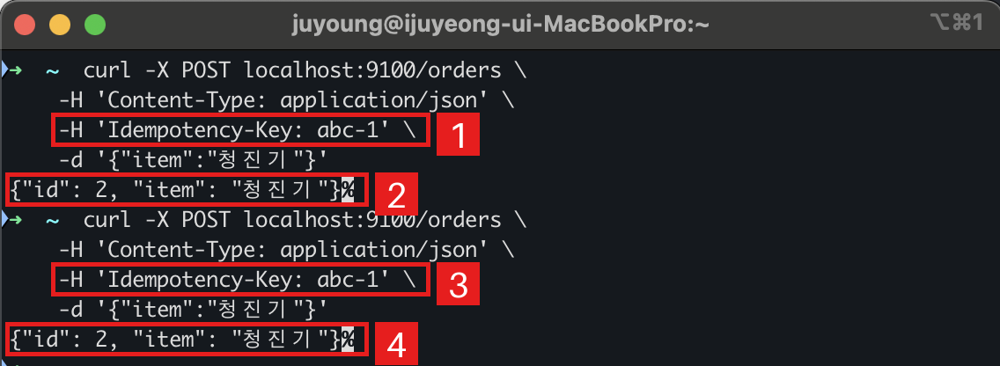

- **1·3** 같은 `Idempotency-Key: abc-1` 로 `POST /orders` 를 두 번 보냈습니다
- **2·4** 두 번 다 `id: 2` → 주문은 한 번만 만들어졌습니다

---

## 1.2 지난 주 과제 C: 앱 예외 → 500

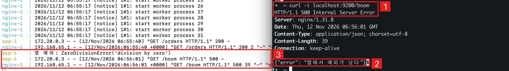

- **1** `curl -i localhost:9200/boom` → `500 Internal Server Error`
- **2·3** 앱이 예외(`ZeroDivisionError`)를 잡고 **직접 500 을 답했습니다**. nginx 는 그대로 전달만 → nginx 에러 로그 없음

---

## 1.3 지난 주 과제 C: 느린 응답 → 504

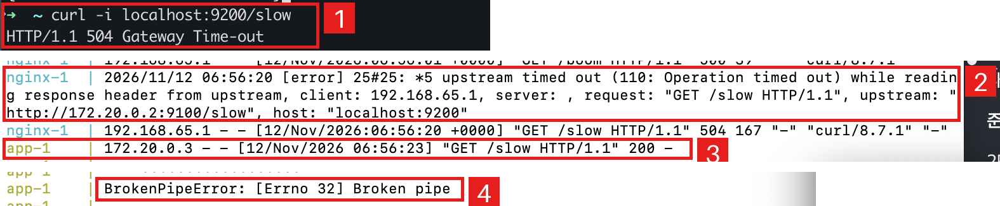

- **1** `curl -i localhost:9200/slow` → `504 Gateway Time-out` (앱은 5초, nginx 는 2초만 기다림)
- **2** nginx: `upstream timed out … while reading response header`
- **3·4** 앱은 3초 뒤 200 으로 답했지만 받을 곳이 없어 `BrokenPipeError`

---

## 1.4 지난 주 과제 C: 앱을 끄면 502… 일까?

```
$ docker compose exec app pkill python      # 앱 프로세스만 죽임
$ curl -i localhost:9200/orders
HTTP/1.1 502 Bad Gateway

nginx | connect() failed (111: Connection refused) while connecting to upstream
```

| 무엇을 껐나                        | nginx 가 겪는 일                | 결과              |
| ---------------------------------- | ------------------------------- | ----------------- |
| 프로세스만 (`pkill python`)        | 주소는 있는데 문이 없음 → 즉시 거절 | **502**, 0.003초 |
| 컨테이너 통째로 (`compose stop app`) | 그 주소에 아무도 없음 → 답이 안 옴 | **504**, 2초 뒤  |

---

<!-- header: '1 과제 C › **2 질문** › 3 HTTP/1.1 › 4 HTTP/2 › 5 HTTP/3 › 6 우리 서비스' -->

# 2. HTTP/1.1 · 2 · 3, 그게 뭐가 중요해?

어차피 클라이언트와 서버가, 서버와 서버가 통신하는 건 똑같은데

```
브라우저 ──HTTP/2──▶ Vercel ──▶ Next.js ──HTTP/1.1──▶ ALB ──HTTP/1.1──▶ NestJS
```

그런데 우리 서비스는 **구간마다 버전이 다릅니다**. 왜 그럴까요?

---

## 2.1 오늘의 흐름: 문제 → 해결 → 새 문제

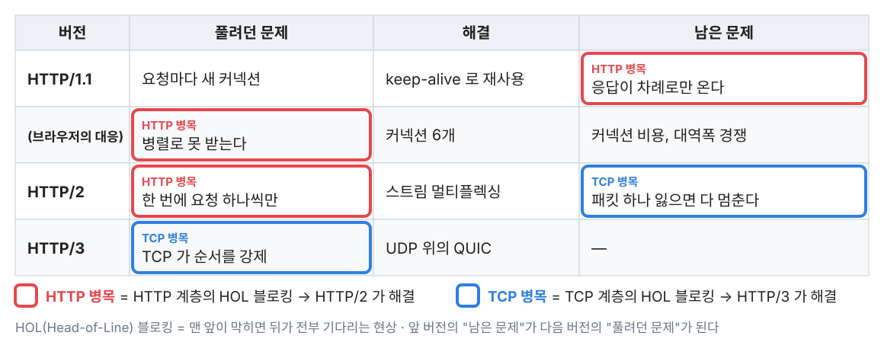

---

<!-- header: '1 과제 C › 2 질문 › **3 HTTP/1.1** › 4 HTTP/2 › 5 HTTP/3 › 6 우리 서비스' -->

## 3.1 HTTP/1.1 (1997): 연결은 재사용, 응답은 차례로

- keep-alive 로 연결 하나를 재사용합니다 (2주차 과제 B 에서 잰 것)
- 그런데 응답에 **번호표가 없습니다** → 요청한 순서대로만 응답할 수 있습니다
- 앞 응답이 늦으면 뒤 응답이 전부 기다립니다 → **HOL 블로킹 (HTTP 계층)**

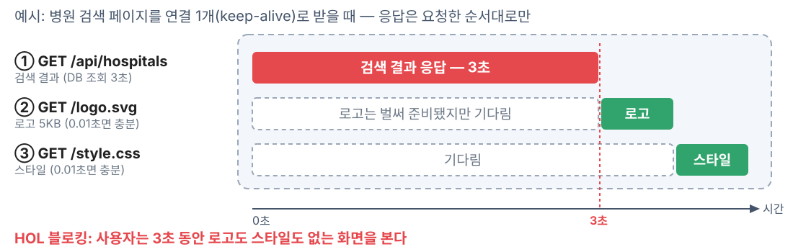

---

## 3.2 브라우저의 대응 (2008): 도메인당 TCP 커넥션 2개 → 6개

- 커넥션 하나에서 병렬 처리가 안 되니, **커넥션 자체를 여러 개** 열어 리소스를 병렬로 받습니다 ([MDN](https://developer.mozilla.org/en-US/docs/Web/HTTP/Guides/Connection_management_in_HTTP_1.x))
- 표준의 권고는 서버당 2개 ([RFC 2616 §8.1.4](https://www.rfc-editor.org/rfc/rfc2616#section-8.1.4)) → 2008년 IE8 · Firefox 3 가 6개로 상향 ([Steve Souders, 2008](https://www.stevesouders.com/blog/2008/03/20/roundup-on-parallel-connections/)) → 이후 표준은 숫자 제한을 삭제 ([RFC 7230 §6.4](https://www.rfc-editor.org/rfc/rfc7230#section-6.4))
- 커넥션을 더 늘리지 못한 이유 (trade-off)
  - 새 커넥션은 핸드셰이크부터, 그리고 "차가운" 상태에서 시작 ([MDN](https://developer.mozilla.org/en-US/docs/Web/HTTP/Guides/Connection_management_in_HTTP_1.x))
  - 커넥션마다 서버 리소스 점유, 너무 많으면 서버가 DoS 로 보고 거절 ([RFC 7230 §6.4](https://www.rfc-editor.org/rfc/rfc7230#section-6.4))
  - 혼잡한 망에서 부작용, 다른 흐름과 경쟁 ([RFC 7230 §6.4](https://www.rfc-editor.org/rfc/rfc7230#section-6.4) · [RFC 7540 §1](https://www.rfc-editor.org/rfc/rfc7540#section-1))
- 같은 뿌리의 프론트엔드 관행: 도메인 샤딩 · 번들링 · 이미지 스프라이트

---

## 3.2.1 근거: MDN 이 말하는 커넥션 비용

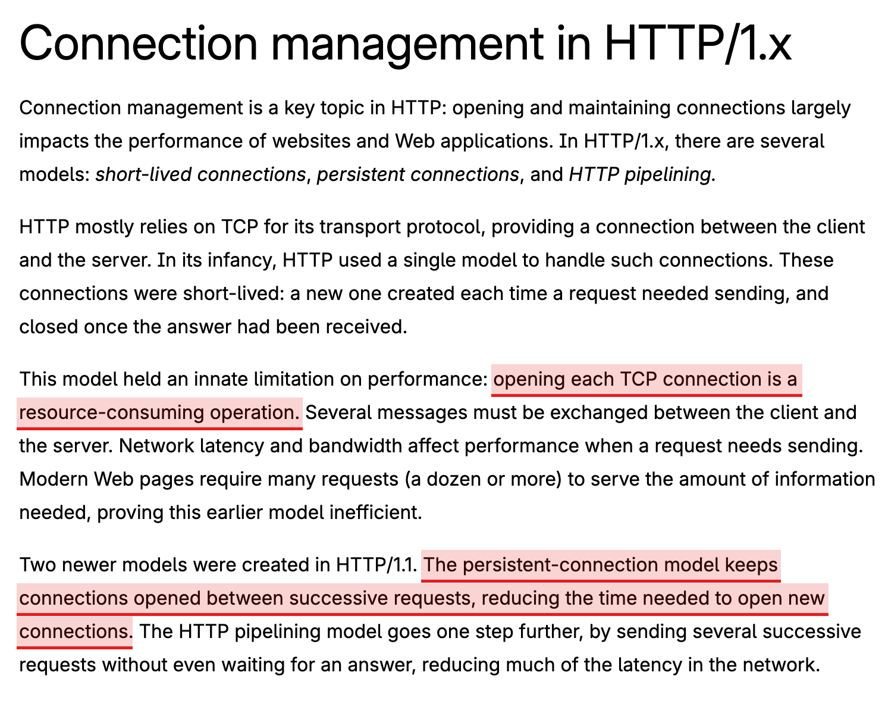

- **TCP 커넥션을 여는 것 자체가 비용**입니다 (여러 메시지를 주고받아야 함)
- 그래서 HTTP/1.1 은 요청 사이에 **커넥션을 열어 둡니다** (persistent connection = keep-alive)
- 커넥션을 늘리는 대응이 공짜가 아닌 이유

[MDN: Connection management in HTTP/1.x](https://developer.mozilla.org/en-US/docs/Web/HTTP/Guides/Connection_management_in_HTTP_1.x)

---

## 3.2.2 직접 재 보기: 커넥션을 여는 비용

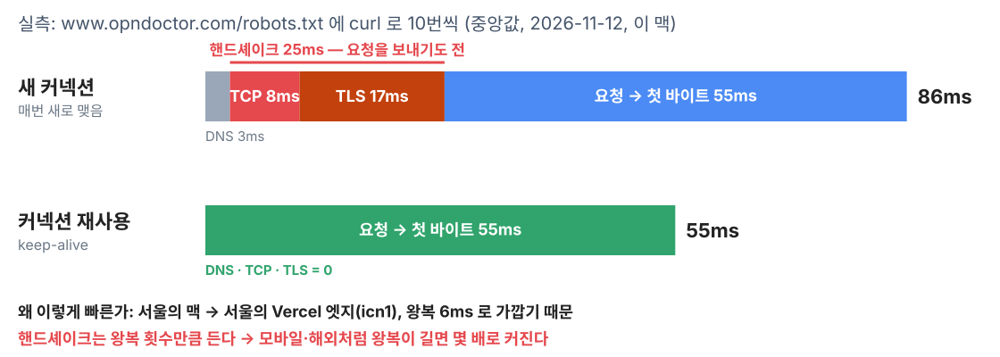

```
curl -s -o /dev/null -o /dev/null -w 'TCP %{time_connect}s TLS %{time_appconnect}s 새연결 %{num_connects}\n' \
  https://www.opndoctor.com/robots.txt https://www.opndoctor.com/robots.txt
```

---

## 3.2.3 근거: 표준이 말하는 부작용

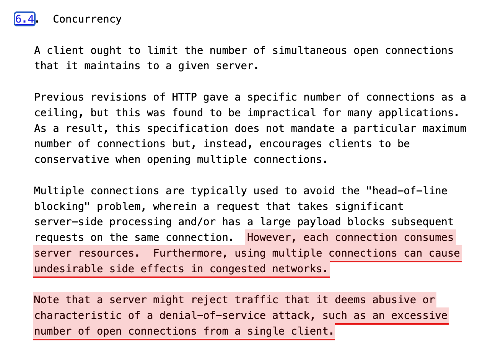

- 커넥션마다 **서버 리소스를 점유**합니다
- 혼잡한 망에서 **원치 않는 부작용**을 냅니다
- 한 클라이언트가 너무 많이 열면 서버가 **DoS 공격으로 보고 거절**할 수 있습니다

[RFC 7230 §6.4 Concurrency](https://www.rfc-editor.org/rfc/rfc7230#section-6.4)

---

## 3.3 프론트 최적화 기법 잠깐 공유: 번들링 · 아이콘 스프라이트

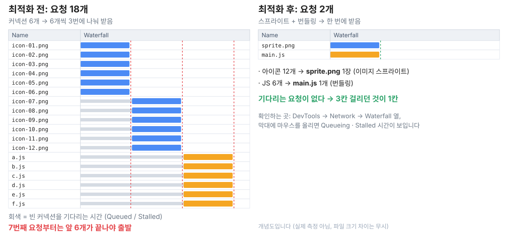

---

<!-- header: '1 과제 C › 2 질문 › 3 HTTP/1.1 › **4 HTTP/2** › 5 HTTP/3 › 6 우리 서비스' -->

## 4.1 HTTP/2 (2015): 연결 하나에 요청을 동시에

- **4.1.1** 구글 SPDY 기반
- **4.1.2** 요청·응답을 **프레임**으로 쪼개고 **스트림 번호**를 붙입니다 → 번호표가 생김
- **4.1.3** 연결 하나에서 여러 응답이 섞여 와도 번호로 다시 맞춥니다 → **멀티플렉싱**
- **4.1.4** HTTP 계층의 **병목(HOL 블로킹)이 사라집니다** → 도메인당 6개짜리 커넥션 풀이 필요 없어집니다

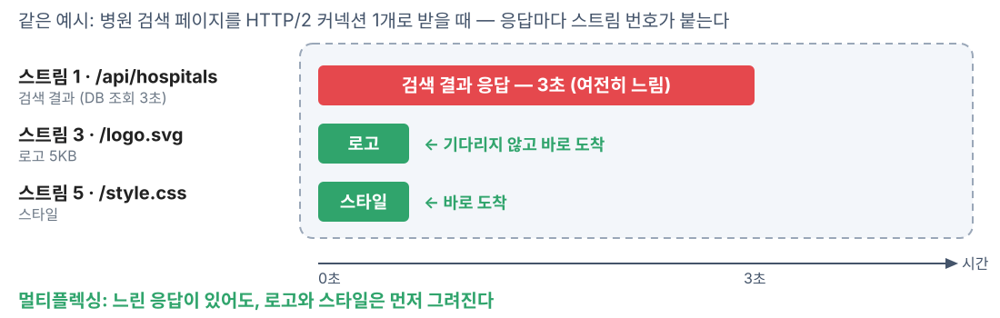

---

## 4.1 프레임 · 스트림 번호 · 멀티플렉싱 한눈에

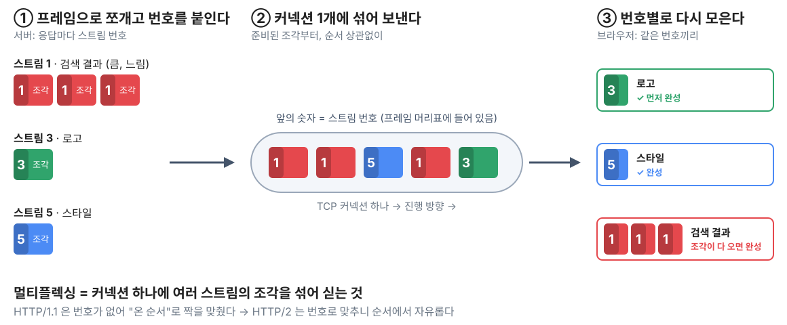

---

## 4.1.2 더 깊이 ①: 프레임은 어떻게 생겼나

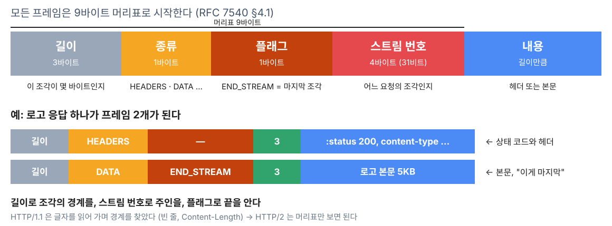

---

## 4.1.3 더 깊이 ②: 스트림 번호를 실제로 보기

```
$ curl -sv -o /dev/null -o /dev/null https://www.opndoctor.com/robots.txt https://www.opndoctor.com/favicon.ico

* using HTTP/2
* [HTTP/2] [1] OPENED stream for https://www.opndoctor.com/robots.txt
* [HTTP/2] [1] [:method: GET]
* [HTTP/2] [1] [:path: /robots.txt]
< HTTP/2 200
* Re-using existing connection with host www.opndoctor.com
* [HTTP/2] [3] OPENED stream for https://www.opndoctor.com/favicon.ico
* [HTTP/2] [3] [:method: GET]
* [HTTP/2] [3] [:path: /favicon.ico]
< HTTP/2 200
```

- `[1]`, `[3]` 이 **스트림 번호**입니다. 클라이언트가 여는 스트림은 홀수 (RFC 7540 §5.1.1)
- `Re-using existing connection` → 커넥션은 **하나**, 그 안에 스트림이 둘

---

## 4.2 그래도 남은 병목: TCP 의 HOL 블로킹

- TCP 의 약속: 받은 바이트를 **보낸 순서 그대로** 올린다 (3주차에 본 Seq · Ack 가 그 장치)
- 패킷 하나를 잃으면, 그 뒤에 도착한 **다른 스트림의 데이터도** 버퍼에서 기다립니다
- 연결이 하나뿐이라 손실이 많은 망에서는 오히려 1.1(연결 6개)보다 불리할 수 있습니다

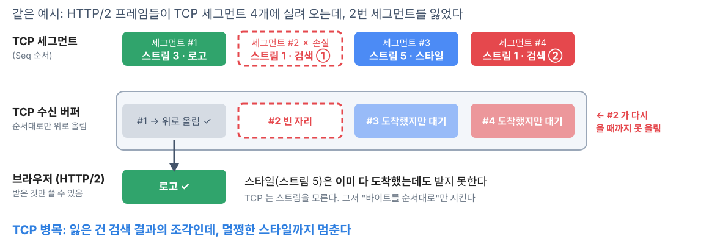

---

## 4.2.1 복습: TCP 는 왜 순서를 지키나 (3주차 Seq · Ack)

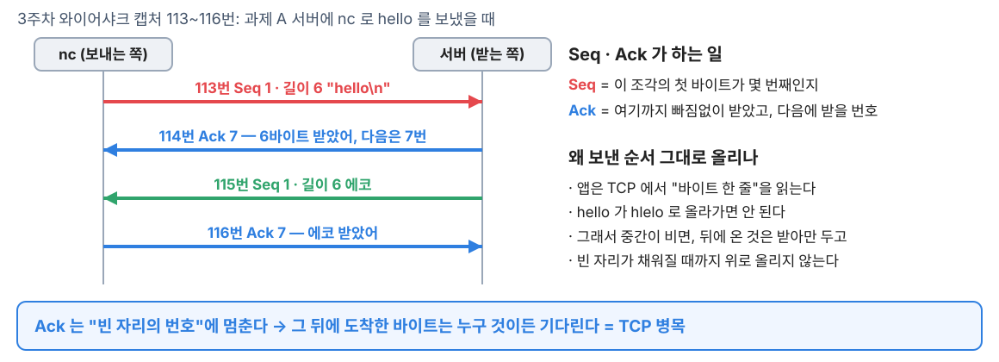

[3주차 슬라이드 (GitHub)](https://github.com/opngroup/network-study-2026/blob/main/week-03/%EC%9D%B4%EC%A3%BC%EC%98%81/slides.md) — 캡처 원본과 표가 여기 있습니다

---

<!-- header: '1 과제 C › 2 질문 › 3 HTTP/1.1 › 4 HTTP/2 › **5 HTTP/3** › 6 우리 서비스' -->

## 5.1 HTTP/3 (2022): TCP 대신 UDP 위의 QUIC

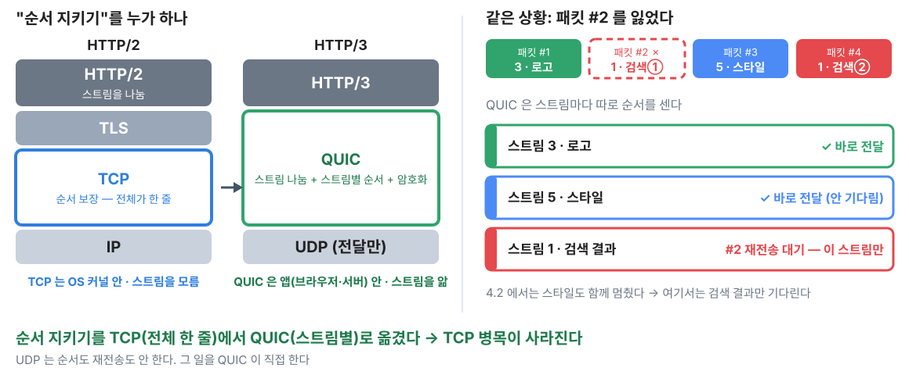

---

## 5.2 HTTP/3 는 TCP 를 타지 않는다

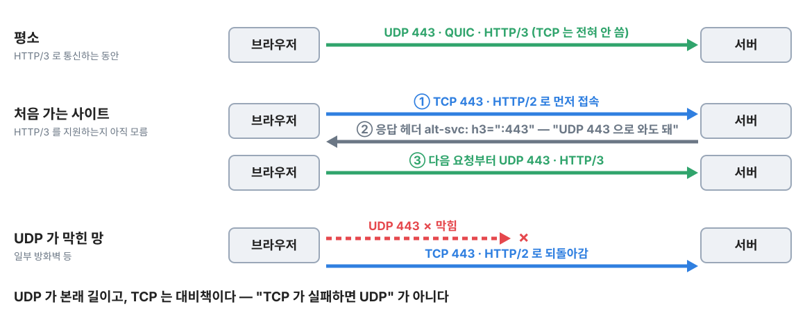

- 실측: 유튜브 · 구글 응답에 `alt-svc: h3=":443"` 있음 / 우리 서비스 · 네이버에는 없음

---

## 5.3 왜 TCP 를 고치지 않고 UDP 위에 새로 만들었을까?

- TCP 는 **OS 커널 안**에 있어 바꾸기 어렵습니다 (OS 업데이트가 필요)
- 중간 장비(방화벽·공유기)가 **낯선 TCP 를 막습니다**
- UDP 는 어디서나 통과 → **앱(브라우저·nginx) 라이브러리만** 업데이트하면 됩니다
- 구글 QUIC 기반 → 표준 HTTP/3 (HTTP/2 가 SPDY 에서 온 것과 같은 길)
- 비유: TCP 는 우체국 등기, QUIC 은 일반 우편 위에 보내는 쪽·받는 쪽이 직접 규칙을 챙기는 것

---

<!-- header: '1 과제 C › 2 질문 › 3 HTTP/1.1 › 4 HTTP/2 › 5 HTTP/3 › **6 우리 서비스**' -->

## 6.1 버전은 누가 고르나

- 백엔드 코드는 버전을 신경 쓰지 않습니다. 메서드·상태 코드·헤더의 **의미는 같고**, 선에 싣는 방식만 다릅니다
- HTTP/2 는 TLS 의 **ALPN** 으로 합의, HTTP/3 는 **Alt-Svc** 헤더로 광고
- 사용 비율 (2026 3분기, 출처 하나 기준 — 출처마다 차이 큼): HTTP/2 약 52% · 1.x 약 27% · 3 약 20%

---

## 6.2 우리 서비스에서는

| 구간                        | 버전     | 근거                                        |
| --------------------------- | -------- | ------------------------------------------- |
| 브라우저 → Vercel           | HTTP/2   | 실측 (`ALPN: server accepted h2`, h3 광고 없음) |
| Next.js → ALB               | HTTP/1.1 | 옵션 없는 Node `fetch` (추정)               |
| ALB → NestJS(apiv2)         | HTTP/1.1 | 대상 그룹 `HTTP`, keep-alive 65초           |
| 브라우저 → CloudFront 이미지 | HTTP/2   | 실측                                        |

```
curl -sv -o /dev/null https://www.opndoctor.com/ 2>&1 | grep ALPN
curl -sI https://www.opndoctor.com/ | grep -i alt-svc
```

---

## 6.3 그래서, 왜 구간마다 다를까?

```
브라우저 ──HTTP/2──▶ Vercel ──▶ Next.js ──HTTP/1.1──▶ ALB ──HTTP/1.1──▶ NestJS
```

| 구간              | 겪는 문제                               | 그래서                                  |
| ----------------- | --------------------------------------- | --------------------------------------- |
| 브라우저 → Vercel | 연결 6개 제한, 먼 거리, 리소스 수십 개  | HTTP/2 가 이득                          |
| 서버 → 서버       | 6개 제한 없음, 가까움, 손실 드묾        | 1.1 + 연결 풀 + keep-alive 로 충분      |
| 유튜브 · 구글     | 모바일처럼 손실 많은 망                 | HTTP/3 까지 (`alt-svc: h3`)             |

**뒤처진 게 아니라, 구간마다 풀 문제가 달라서 다릅니다.**
